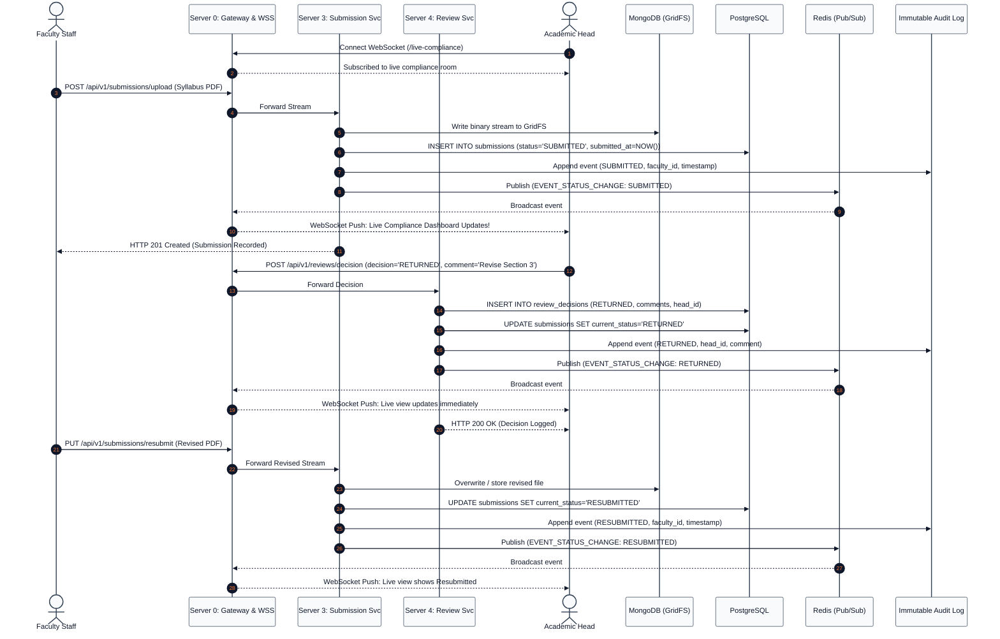

# Spec-Driven Development (SDD) Phase 2: Design Specification
## Syllabus Compliance Monitoring System (SCMS)

**Architectural Paradigm:** Microservices with API Gateway, Polyglot Persistence & Real-Time WebSocket Bus  
**Campus:** Polytechnic University of the Philippines Quezon City Campus (PUPQC)  
**Reference Document:** [System Architecture and Diagrams](../../docs/system_architecture_and_diagrams.md)

---

## 1. System Topology & Microservices Breakdown

SCMS deploys an **API Gateway (Server 0)** that terminates public client traffic, manages WebSocket channels, and proxies REST requests across **5 dedicated backend microservices**:

```
[ React SPA Client ]
         │ (HTTPS / WSS)
         ▼
[ Server 0: API Gateway ]
         │
   ┌─────┴───────────────┬──────────────────────┬──────────────────────┬──────────────────────┐
   ▼                     ▼                      ▼                      ▼                      ▼
[ Server 1 ]          [ Server 2 ]           [ Server 3 ]           [ Server 4 ]           [ Server 5 ]
Identity & Access     Requirements           Submission & Storage   Review & Audit         Live Compliance
   │                     │                      │                      │                      │
   ├─────────────────────┼──────────────────────┴──────────────────────┼──────────────────────┘
   ▼                     ▼                                             ▼
[ PostgreSQL DB ]     [ MongoDB GridFS ]                             [ Redis Cluster ]
```

---

## 2. Service Responsibilities & API Contracts

### Server 0: API Gateway & WebSocket Router
* Exposes `/api/v1/*` routes and `/live-compliance` WebSocket endpoint.
* Enforces role validation strictly for **Academic Head** and **Faculty Staff** (`RoleGuard`).
* **Authentication & Error Handling:**
  * Missing or invalid session cookie/token returns **HTTP 401 Unauthorized**.
  * Unauthorized write attempts return **HTTP 403 Forbidden** with descriptive message on screen (`Access denied: Your role does not permit this action`).
* Broadcasts real-time submission status mutations to connected Academic Head client sockets.

### Server 1: Identity & Access Service (Module A / M1)
* **Authentication Architecture:**
  * **Primary:** PUP QC AAIP Clerk Shared SSO via OIDC (`POST /auth/clerk-login`). Validates Clerk JWT under an Invite-Only policy (unregistered emails rejected with HTTP 403 Forbidden), mapping strictly to existing local PostgreSQL accounts with SCMS-scoped roles (`ACADEMIC_HEAD` or `FACULTY_STAFF`). No auto-JIT account creation is permitted.
  * **Fallback:** Emergency Local Argon2id authentication (`POST /auth/login`). Verifies credentials against local PostgreSQL `users` table to guarantee zero downtime during network or Clerk key transitions.
* **Endpoints:**
  * `POST /auth/clerk-login` — Validates Clerk session token via `@clerk/backend`, maps institutional email, and issues SCMS JWT.
  * `POST /auth/login` — Verifies local credentials with Argon2id hash against SCMS's own user accounts. On failure, returns **HTTP 401** with generic message (`Invalid credentials`) without revealing which field was incorrect. Issues HttpOnly JWT session cookie.
  * `POST /auth/logout` — Blacklists token in Redis and clears HttpOnly session cookie.
  * `GET /users/me` — Returns authenticated profile with role (`ACADEMIC_HEAD` or `FACULTY_STAFF`).
  * `GET /faculty/lookup/:facultyId` — Queries FMS adapter for minimal profile details (`name`, `college`, `unit`); caches in Redis.
* **Data Privacy Controls (RA 10173):**
  * Limits read, stored, and displayed faculty attributes strictly to `{ name, college, unit }`.
  * Restricts access to uploaded syllabus documents strictly to the owning faculty member and the Academic Head.
* **Database Access:** PostgreSQL `users`, `roles`.

### Server 2: Academic Requirements Service (Module B / M2)
* **Endpoints:**
  * `POST /requirements` — Academic Head creates requirement per program and term with name and description. Restricts to Academic Head (403 for Faculty Staff).
  * `PUT /requirements/:id` — Academic Head edits draft requirement details; saved changes appear immediately.
  * `PATCH /requirements/:id/publish` — Validates term deadline exists; transitions status from `DRAFT` to `PUBLISHED`.
  * `PATCH /requirements/:id/close` — Academic Head transitions requirement to `CLOSED`.
  * `PATCH /requirements/:id/deadline` — Updates term deadline; logs previous/new deadline and actor via audit logger.
  * `GET /requirements` — Filtered by role: Academic Head sees all (Draft, Published, Closed); Faculty Staff sees only Published and Closed.
  * `POST /calendar/sync-ccms` — Ingests official term dates from CCMS.
* **Database Access:** PostgreSQL `requirement_definitions`, `programs`, `term_calendars`.

### Server 3: Syllabus Submission & Document Storage Service (Module C / M3)
* **Endpoints:**
  * `POST /submissions/upload` — Multipart stream upload. Stores PDF/DOCX in MongoDB GridFS, sets status to `SUBMITTED`, records timestamp, publishes real-time event.
  * `POST /submissions/form` — Form-based syllabus entry stored in MongoDB.
  * `GET /submissions/:id/file` — Streams file from MongoDB GridFS using a short-lived stream URL.
  * `PUT /submissions/:id/resubmit` — Updates submission to `RESUBMITTED` with newly uploaded file.
* **Database Access:** PostgreSQL `submissions`; MongoDB `fs.files`, `fs.chunks`, `syllabus_payloads`.

### Server 4: Review, Approval & Audit Service (Module C / M4, M7)
* **Endpoints:**
  * `POST /reviews/:submissionId/decision` — Academic Head records approval (`APPROVED`) or return for revision (`RETURNED` + comments).
  * `POST /audit/log` — Reusable logging interface storing `{ action, actor_id, actor_name, actor_role, entity_name, entity_id, previous_value, new_value, timestamp, client_ip }`.
  * `GET /audit-logs` — Read-only query for the Academic Head to inspect all system actions.
* **Database Access:** PostgreSQL `review_decisions`, `audit_logs` (Append-only protected by database rules/triggers); MongoDB `audit_snapshots`.
* **Real-Time Trigger:** Publishes review status changes to Redis for instant WebSocket broadcast.

### Server 5: Live Compliance Monitoring & Integration Service (Module D / M6)
* **Endpoints:**
  * `GET /compliance/live` — Returns live counts per status (`Not Submitted`, `Submitted`, `Under Review`, `Returned`, `Resubmitted`, `Approved`, `Overdue`) grouped by program and faculty.
  * `POST /integrations/ccms/push-summary` — Transmits consolidated compliance summary feed to CCMS.
* **Background Worker:** Nightly BullMQ cron evaluates deadlines and dynamically flags unapproved submissions as `OVERDUE`.

---

## 3. Sequence Diagram: Live Submission & Review Loop



---

## 4. Error Handling & Circuit Breaker Strategy

| Failure Scenario | Impact | Mitigation Strategy |
| :--- | :--- | :--- |
| **FMS Lookup Unavailable (Warm Cache)** | Cannot query live faculty metadata. | **Circuit Breaker:** Serves cached reference snapshot from Redis (<5ms). Displays an informational banner. |
| **FMS Lookup Unavailable (Expired Cache)** | Cache TTL (>24h) elapsed while FMS remains down. | **Stale-While-Revalidate:** Continues serving stale snapshot for syllabus authoring with `[CACHED SNAPSHOT - STALE]` tag. Outage alone never cancels classes. |
| **FMS First Use / Cold Start (Empty Cache)** | System startup with zero cached FMS data and unreachable FMS. | **Synthetic Fixture Fallback:** Automatically loads certified mock fixtures from `fixtures/fms_synthetic_fixture.json` with explicit `[FIXTURE DATA: FMS UNCONNECTED]` badge. |
| **Missing Optional Metadata** | Consultation hours or rank missing/null from FMS. | **Graceful Default Fallback:** Renders departmental standard (`"By appointment via MS Teams"`) without blocking syllabus submission or approval. |
| **CCMS Connection Down** | Cannot push compliance summary feed. | **Message Buffer:** Queues status push in Redis BullMQ with exponential backoff retries. |
| **Corrupted File Upload** | Invalid file signature. | **Magic-Byte Guard:** Stream is validated against PDF/DOCX magic bytes before reaching GridFS. |

---

## 5. Joint Acceptance Gate Matrix (Scenarios J1 to J16)
The system architecture implements and verifies all 16 cross-system integration scenarios negotiated with FMS and CCMS:
* **J1 (Catalogue Pull & Allocation Approval):** FMS queries SMS catalog, approves allocation, pushes assignment; exactly **one** compliance item generated in SMS (`NOT_SUBMITTED`).
* **J2 (Timetable Finalization):** Post-approval schedule/room update without duplicate compliance items or deadline shifts.
* **J3 (Reassignment, Withdrawal & Substitution):** Assignment updates effective instructor; withdrawal transitions to `UNASSIGNED`; substitute teacher granted co-instructor read access without transferring legal signatory accountability.
* **J4 (Course Retirement / Contact Hour Revision):** New assignments respect updated curriculum; existing schedules and historical audit logs remain preserved.
* **J5 (Faculty Identity Stability):** Domain entities link strictly via immutable `faculty_id`; email changes do not sever past syllabus associations.
* **J6 (Idempotency & Replay):** Monotonic version comparison (`assignment_version`) rejects duplicate or out-of-order deliveries.
* **J7–J9 (Calendar & Intraday Suspensions):** CCMS calendar suspensions evaluated in Asia/Manila timezone without office working hours overwriting teaching timetables.
* **J10–J12 (Resilience & Outage Recovery):** Deterministic snapshot recovery, warm vs. expired cache handling, and cold-start synthetic fixture fallback.
* **J13–J16 (Security & Block Section Lifecycle):** Scoped machine tokens (OAuth 2.0 / TLS 1.3), role separation, backward schema compatibility, and Block Section renaming preserving stable cohort admission year.
