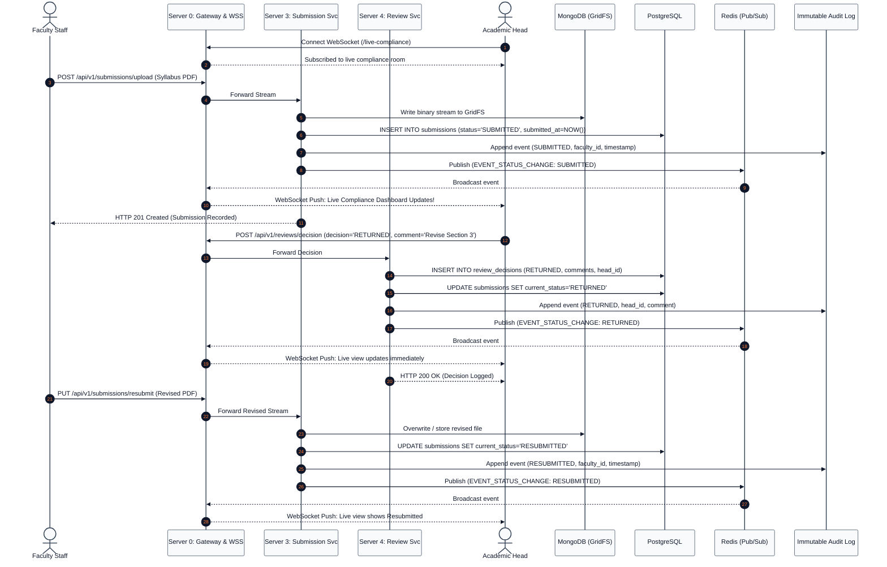

# Spec-Driven Development (SDD) Phase 2: Design Specification
## Syllabus Compliance Monitoring System (SCMS)

**Architectural Paradigm:** Microservices with API Gateway, Polyglot Persistence & Real-Time WebSocket Bus  
**Campus:** Polytechnic University of the Philippines Quezon City Campus (PUPQC)  
**Reference Document:** [System Architecture and Diagrams](../../docs/system_architecture_and_diagrams.md)

---

## 1. System Topology & Microservices Breakdown

SCMS deploys an **API Gateway (Server 0)** that terminates public client traffic, manages WebSocket channels, and proxies REST requests across **5 dedicated backend microservices**:

```
[ React SPA Client ]
         │ (HTTPS / WSS)
         ▼
[ Server 0: API Gateway ]
         │
   ┌─────┴───────────────┬──────────────────────┬──────────────────────┬──────────────────────┐
   ▼                     ▼                      ▼                      ▼                      ▼
[ Server 1 ]          [ Server 2 ]           [ Server 3 ]           [ Server 4 ]           [ Server 5 ]
Identity & Access     Requirements           Submission & Storage   Review & Audit         Live Compliance
   │                     │                      │                      │                      │
   ├─────────────────────┼──────────────────────┴──────────────────────┼──────────────────────┘
   ▼                     ▼                                             ▼
[ PostgreSQL DB ]     [ MongoDB GridFS ]                             [ Redis Cluster ]
```

---

## 2. Service Responsibilities & API Contracts

### Server 0: API Gateway & WebSocket Router
* Exposes `/api/v1/*` routes and `/live-compliance` WebSocket endpoint.
* Enforces role validation strictly for **Academic Head** and **Faculty Staff** (`RoleGuard`).
* **Authentication & Error Handling:**
  * Missing or invalid session cookie/token returns **HTTP 401 Unauthorized**.
  * Unauthorized write attempts return **HTTP 403 Forbidden** with descriptive message on screen (`Access denied: Your role does not permit this action`).
* Broadcasts real-time submission status mutations to connected Academic Head client sockets.

### Server 1: Identity & Access Service (Module A / M1)
* **Endpoints:**
  * `POST /auth/login` — Verifies local credentials with Argon2id hash against SCMS's own user accounts. On failure, returns **HTTP 401** with generic message (`Invalid credentials`) without revealing which field was incorrect. Issues HttpOnly JWT session cookie; no SSO or shared session with CCMS/FMS.
  * `POST /auth/logout` — Blacklists token in Redis and clears HttpOnly session cookie.
  * `GET /users/me` — Returns authenticated profile with role (`ACADEMIC_HEAD` or `FACULTY_STAFF`).
  * `GET /faculty/lookup/:facultyId` — Queries FMS adapter for minimal profile details (`name`, `college`, `unit`); caches in Redis.
* **Data Privacy Controls (RA 10173):**
  * Limits read, stored, and displayed faculty attributes strictly to `{ name, college, unit }`.
  * Restricts access to uploaded syllabus documents strictly to the owning faculty member and the Academic Head.
* **Database Access:** PostgreSQL `users`, `roles`.

### Server 2: Academic Requirements Service (Module B / M2)
* **Endpoints:**
  * `POST /requirements` — Academic Head configures syllabus requirement per program and term.
  * `GET /requirements/term/:termId` — Lists active program requirements and deadlines.
  * `POST /calendar/sync-ccms` — Ingests official term dates from CCMS.
* **Database Access:** PostgreSQL `requirement_definitions`, `term_calendars`.

### Server 3: Syllabus Submission & Document Storage Service (Module C / M3)
* **Endpoints:**
  * `POST /submissions/upload` — Multipart stream upload. Stores PDF/DOCX in MongoDB GridFS, sets status to `SUBMITTED`, records timestamp, publishes real-time event.
  * `POST /submissions/form` — Form-based syllabus entry stored in MongoDB.
  * `GET /submissions/:id/file` — Streams file from MongoDB GridFS using a short-lived stream URL.
  * `PUT /submissions/:id/resubmit` — Updates submission to `RESUBMITTED` with newly uploaded file.
* **Database Access:** PostgreSQL `submissions`; MongoDB `fs.files`, `fs.chunks`, `syllabus_payloads`.

### Server 4: Review, Approval & Audit Service (Module C / M4, M7)
* **Endpoints:**
  * `POST /reviews/:submissionId/decision` — Academic Head records approval (`APPROVED`) or return for revision (`RETURNED` + comments).
  * `GET /audit-logs` — Read-only query for the Academic Head to inspect all system actions.
* **Database Access:** PostgreSQL `review_decisions`, `audit_logs` (Append-only); MongoDB `audit_snapshots`.
* **Real-Time Trigger:** Publishes review status changes to Redis for instant WebSocket broadcast.

### Server 5: Live Compliance Monitoring & Integration Service (Module D / M6)
* **Endpoints:**
  * `GET /compliance/live` — Returns live counts per status (`Not Submitted`, `Submitted`, `Under Review`, `Returned`, `Resubmitted`, `Approved`, `Overdue`) grouped by program and faculty.
  * `POST /integrations/ccms/push-summary` — Transmits consolidated compliance summary feed to CCMS.
* **Background Worker:** Nightly BullMQ cron evaluates deadlines and dynamically flags unapproved submissions as `OVERDUE`.

---

## 3. Sequence Diagram: Live Submission & Review Loop



---

## 4. Error Handling & Circuit Breaker Strategy

| Failure Scenario | Impact | Mitigation Strategy |
| :--- | :--- | :--- |
| **FMS Lookup Unavailable** | Cannot query live faculty names or subject tags. | **Circuit Breaker:** Serves cached reference data from Redis. SCMS continues recording submissions and reviews normally and displays an informational banner. |
| **CCMS Connection Down** | Cannot push compliance summary feed. | **Message Buffer:** Queues status push in Redis BullMQ with exponential backoff retries. |
| **Corrupted File Upload** | Invalid file signature. | **Magic-Byte Guard:** Stream is validated against PDF/DOCX magic bytes before reaching GridFS. |
