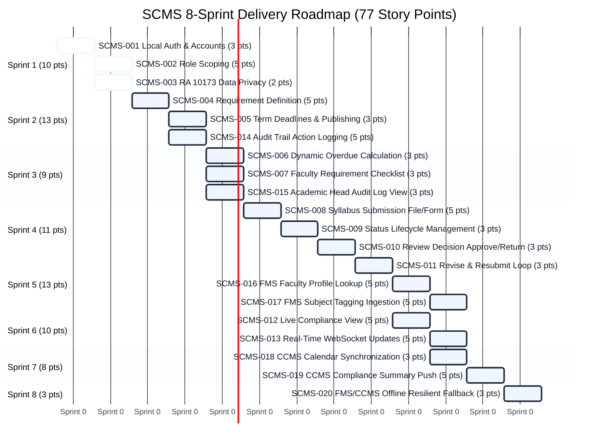

# SCMS Product Backlog & Sprint Plan
**System:** Syllabus Compliance Monitoring System (SCMS)  
**Institution:** Polytechnic University of the Philippines — Quezon City Campus (PUPQC)  
**Total User Stories:** 20 | **Total Story Points:** 77 | **Sprint Duration:** 8 Sprints

---

## 1. Summary by Module

| Module | Description | Stories | Total Points | Sprints |
| :--- | :--- | :---: | :---: | :---: |
| **Module A: Identity and Roles** | Own accounts, roles, data privacy, and read-only faculty profile lookup from FMS | 4 | 15 | Sprint 1, Sprint 5 |
| **Module B: Requirements and Deadlines** | Program submission requirements, term deadlines, overdue calculation, and CCMS term calendar | 4 | 14 | Sprint 2, Sprint 3, Sprint 7 |
| **Module C: Submission and Review** | Syllabus submission (file/form), status lifecycle, single-level review decisions, resubmission, audit trail, and FMS subject assignments | 8 | 30 | Sprint 2, Sprint 3, Sprint 4, Sprint 5 |
| **Module D: Monitoring and Reports** | Real-time live compliance view, immediate updates, and CCMS compliance status summary | 3 | 15 | Sprint 6, Sprint 7 |
| **Cross-Cutting (Modules A to D)** | Offline resilience and fallback when FMS or CCMS is unreachable | 1 | 3 | Sprint 8 |
| **TOTALS** | | **20** | **77** | **8 Sprints** |

---

## 2. Complete User Stories Backlog

### Module A: Identity and Roles
*Own accounts, roles, data privacy, and the read-only faculty profile lookup from FMS*

| Story ID | User Story | Requirement Ref | Prev. Module | Sprint | Points | Status |
| :--- | :--- | :--- | :---: | :---: | :---: | :---: |
| **SCMS-001** | As a user (Academic Head or Faculty Staff), I want to sign in with an SCMS account so that I can use the system without depending on a CCMS or FMS login. | Identity and Access | M1 | **Sprint 1** | 3 | Completed |
| **SCMS-002** | As a user, I want access to be determined by my role so that I only see what my role allows. | Identity and Access | M1 | **Sprint 1** | 5 | Completed |
| **SCMS-003** | As a Faculty Staff member, I want my personal data handled in line with the Data Privacy Act so that my information is protected. | Identity and Access | M1 | **Sprint 1** | 2 | Completed |
| **SCMS-016** | As the Academic Head, I want faculty name, college and unit read from FMS so that identity data is not duplicated. | FMS and CCMS Integration | M1 | **Sprint 5** | 5 | Pending |

---

### Module B: Requirements and Deadlines
*What each program must submit each term and by when, with the term calendar from CCMS*

| Story ID | User Story | Requirement Ref | Prev. Module | Sprint | Points | Status |
| :--- | :--- | :--- | :---: | :---: | :---: | :---: |
| **SCMS-004** | As the Academic Head, I want to define what each program must submit for a term so that Faculty Staff know what is required. | Requirements & Deadline Setup | M2 | **Sprint 2** | 5 | Pending |
| **SCMS-005** | As the Academic Head, I want to set a deadline for each requirement and publish or close it so that submissions follow the term schedule. | Requirements & Deadline Setup | M2 | **Sprint 2** | 3 | Pending |
| **SCMS-006** | As the Academic Head, I want the system to calculate which submissions are overdue so that late items are identified without manual updates. | Requirements & Deadline Setup | M2 | **Sprint 3** | 3 | Pending |
| **SCMS-018** | As the Academic Head, I want term dates and holidays read from the official CCMS calendar so that deadlines follow one calendar. | FMS and CCMS Integration | M2 | **Sprint 7** | 3 | Pending |

---

### Module C: Submission and Review
*Submission, status lifecycle, review decisions, resubmission, the audit trail, and subject assignments from FMS*

| Story ID | User Story | Requirement Ref | Prev. Module | Sprint | Points | Status |
| :--- | :--- | :--- | :---: | :---: | :---: | :---: |
| **SCMS-007** | As a Faculty Staff member, I want to see the requirements I must submit so that I know what is due and by when. | Submission and Review | M3 | **Sprint 3** | 3 | Pending |
| **SCMS-008** | As a Faculty Staff member, I want to submit a syllabus for each subject I teach, as an uploaded file or a form, so that my compliance is recorded. | Submission and Review | M3 | **Sprint 4** | 5 | Pending |
| **SCMS-009** | As the Academic Head, I want submissions to move through defined statuses so that each stage is timestamped and attributed. | Submission and Review | M3 to M5 | **Sprint 4** | 3 | Pending |
| **SCMS-010** | As the Academic Head, I want to approve or return a submission with a recorded decision so that review outcomes are traceable. | Submission and Review | M4 | **Sprint 4** | 3 | Pending |
| **SCMS-011** | As a Faculty Staff member, I want to read the Academic Head's comment and resubmit a revised version so that I can reach approval. | Submission and Review | M5 | **Sprint 5** | 3 | Pending |
| **SCMS-014** | As the Academic Head, I want every submission action and review decision logged so that accountability and traceability are ensured. | Notifications & Audit Log | M7 | **Sprint 2** | 5 | Pending |
| **SCMS-015** | As the Academic Head, I want to view the audit trail so that I can verify who did what and when. | Notifications & Audit Log | M7 | **Sprint 3** | 3 | Pending |
| **SCMS-017** | As the Academic Head, I want faculty subject assignments read from FMS so that the system knows who must submit what. | FMS and CCMS Integration | M3 | **Sprint 5** | 5 | Pending |

---

### Module D: Monitoring and Reports
*The live compliance view, real-time updates, and the compliance status summary sent to CCMS*

| Story ID | User Story | Requirement Ref | Prev. Module | Sprint | Points | Status |
| :--- | :--- | :--- | :---: | :---: | :---: | :---: |
| **SCMS-012** | As the Academic Head, I want a live view of who has and has not complied so that I can follow up. | Compliance Monitoring | M6 | **Sprint 6** | 5 | Pending |
| **SCMS-013** | As the Academic Head, I want the compliance view to update immediately as submissions and decisions are made so that I always see the current status. | Compliance Monitoring | M6 | **Sprint 6** | 5 | Pending |
| **SCMS-019** | As the Academic Head, I want a compliance status summary sent to CCMS so that the CCMS dashboard shows academic compliance. | FMS and CCMS Integration | M6 | **Sprint 7** | 5 | Pending |

---

### Cross-Cutting (Modules A to D)
*Applies to every module that uses FMS or CCMS data*

| Story ID | User Story | Requirement Ref | Prev. Module | Sprint | Points | Status |
| :--- | :--- | :--- | :---: | :---: | :---: | :---: |
| **SCMS-020** | As the Academic Head, I want SCMS to keep working when FMS or CCMS cannot be reached so that submissions and reviews are not interrupted. | FMS & CCMS Integration | Cross-cutting | **Sprint 8** | 3 | Pending |

---

## 3. Sprint Backlog — Sprint 1

**Sprint Goal:** Establish SCMS's own sign-in, role-based access scoping for the Academic Head and Faculty Staff, and data privacy controls.  
**Total Story Points:** 10 Points | **Target Sprints:** Sprint 1 | **Status:** Completed ✅

| User Story Number | User Story | Tasks | Acceptance Criteria / Task | Assignee/s | Remarks (Story Points) | Status |
| :--- | :--- | :--- | :--- | :---: | :---: | :---: |
| **SCMS-001** | As a user (Academic Head or Faculty Staff), I want to sign in with an SCMS account so that I can use the system without depending on a CCMS or FMS login. | **Task 1:** Build the sign-in page and an authentication service that uses SCMS's own user accounts, with passwords stored securely. | **AC 1:** Users sign in with their SCMS credentials; no password is stored in plain text. | Developers | 3 | Completed |
| | | **Task 2:** Reject invalid credentials with a clear error message that does not reveal which field was wrong. | **AC 2:** Invalid credentials are rejected and no session is created. | Developers | | Completed |
| | | **Task 3:** Issue sessions only from SCMS, with no single sign-on or shared session with CCMS or FMS. | **AC 3:** Signing in to CCMS or FMS does not grant access to SCMS, and the reverse is also true. | Developers | | Completed |
| **SCMS-002** | As a user, I want access to be determined by my role so that I only see what my role allows. | **Task 1:** Define the two roles (Academic Head and Faculty Staff) and attach the role to the session on every authenticated request. | **AC 1:** The role is correctly identified on every request; a missing or invalid session returns 401; no other role exists. | Developers | 5 | Completed |
| | | **Task 2:** Enforce role scoping on read endpoints: Faculty Staff see only their own submissions, and the Academic Head sees all requirements, submissions, the compliance view and the audit trail. | **AC 2:** Each role sees only the data within its authorized scope. | Developers | | Completed |
| | | **Task 3:** Block write endpoints a role is not allowed to use and return 403, with a descriptive message on screen. | **AC 3:** Unauthorized requests return 403, no data is changed, and the user sees a descriptive message. | Developers | | Completed |
| **SCMS-003** | As a Faculty Staff member, I want my personal data handled in line with the Data Privacy Act so that my information is protected. | **Task 1:** Limit the faculty fields SCMS reads, stores and displays to those needed (name, college, unit), and review each field against its use. | **AC 1:** Only the required faculty fields are read and stored. | Developers | 2 | Completed |
| | | **Task 2:** Restrict a faculty member's documents to that faculty member and the Academic Head. | **AC 2:** No other user can open a faculty member's documents. | Developers | | Completed |

---

## 4. Sprint Delivery Roadmap (Sprints 1 to 8)

