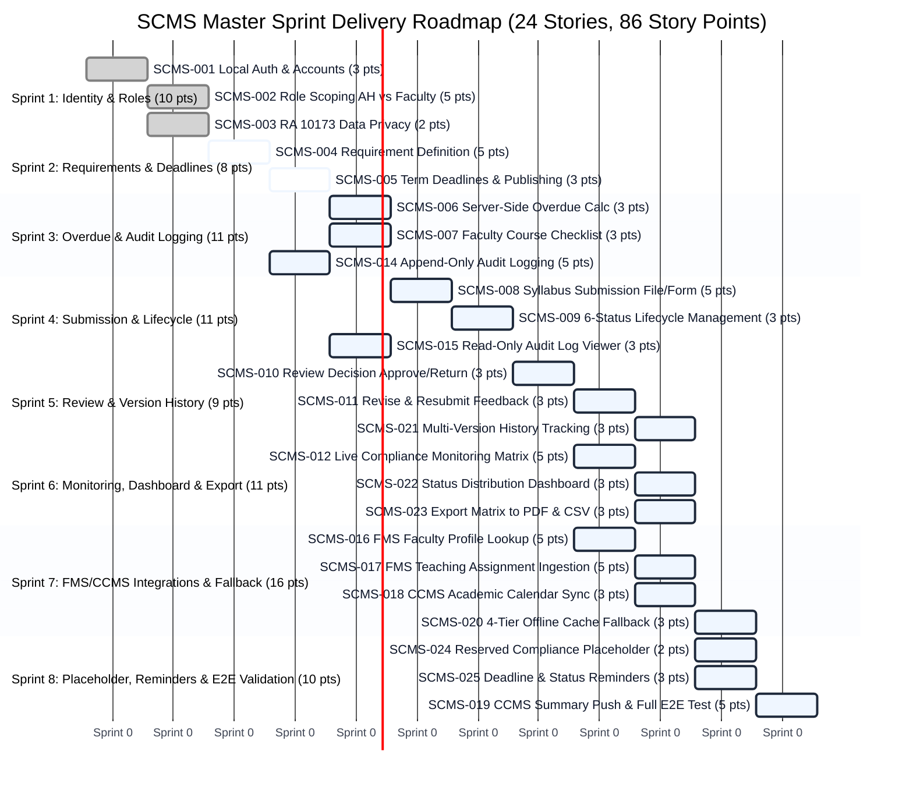

# SCMS Product Backlog & Sprint Plan (Comprehensive Multi-System Reconciled Edition)
**System:** Academic Catalog & Syllabus Management System / Syllabus Compliance Monitoring System (SCMS / SMS)  
**Institution:** Polytechnic University of the Philippines – Quezon City Campus (PUPQC)  
**Total User Stories:** 24 User Stories (`AUD-001` through `AUD-025`, unified as `SCMS-001` through `SCMS-025`)  
**Total Story Points:** 86 Story Points  
**Sprint Cadence:** 8 Two-Week Sprints (16 Weeks Total)  
**Status Baseline:** Sprint 1 Completed (10 pts) ✅ | Sprint 2 Baseline / In Progress (8 pts) 🔄 | Sprints 3–8 Development Paused for Fundamental Multi-System Architecture Alignment ⏸️

---

## 1. Executive Summary & Module Breakdown

This Product Backlog formally harmonizes and reconciles the original 24 user stories from the institutional audit backlog (`AUD-001` through `AUD-025`) with the architectural specifications and data contracts established during the comprehensive 17-page **FMS and CCCMS Integration Review**.

### Core Architecture & Contract Principles
1. **SSOT Data Ownership:** SMS/SCMS is the authoritative Single Source of Truth for Academic Programs, Curricula, Course Master records (credit units, lecture/lab contact hours, facility flags), Academic Terms, and Stable Block Sections (`block_sections`). FMS is the SSOT for Faculty Profiles and Teaching Assignments. CCMS is the SSOT for Academic Calendar Dates and Intraday Suspensions.
2. **Two-Stage Assignment Trigger:** FMS teaching assignments trigger syllabus monitoring upon human approval (`teaching_assignment.approved`) weeks before timetables exist. Timetable and classroom finalization updates the record later (`teaching_assignment.schedule_finalized`).
3. **Data Privacy (RA 10173):** Personal phone numbers, home addresses, and private contact channels are excluded from SCMS storage. Ingested faculty identity is strictly limited to `faculty_id`, `display_name`, `institutional_email`, and consultation hours/academic rank.
4. **4-Tier Offline Resiliency:** If FMS or CCMS is unreachable, SCMS maintains continuous local operations using: (1) Warm Redis/PostgreSQL Cache (TTL 24h), (2) Expired/Stale Cache with amber UI notices, (3) Cold-Start Synthetic Fixtures (`fixtures/fms_synthetic_fixture.json`), and (4) Missing Field Fallbacks.
5. **Joint Acceptance Gate (J1–J16):** All integration stories across Sprints 7 and 8 are validated against 16 joint scenarios with FMS and CCMS before defense readiness.

### Module Summary Table

| Module | Scope Description | User Stories Included | Story Points | Target Sprints |
| :--- | :--- | :---: | :---: | :---: |
| **Module A: Identity and Roles** | Local SCMS authentication, strict two-role scoping (Academic Head & Faculty Staff), RA 10173 data privacy controls, and read-only FMS faculty profile lookup. | `SCMS-001` (`AUD-001`), `SCMS-002` (`AUD-002`), `SCMS-003` (`AUD-003`), `SCMS-016` (`AUD-021`) | 15 pts | Sprint 1, Sprint 7 |
| **Module B: Requirements and Deadlines** | Program submission requirements, term deadlines, automatic server-side overdue calculation, CCMS academic calendar sync, and automated deadline reminders. | `SCMS-004` (`AUD-004`), `SCMS-005` (`AUD-005`), `SCMS-006` (`AUD-007`), `SCMS-018` (`AUD-023`), `SCMS-025` (`AUD-018`) | 16 pts | Sprint 2, Sprint 3, Sprint 7, Sprint 8 |
| **Module C: Submission and Review** | Syllabus submission (file/form), status lifecycle (6 statuses), single-level review decisions (Approve/Return), revise & resubmit loop, multi-version history, append-only audit logging, and FMS teaching assignment ingestion. | `SCMS-007` (`AUD-008`), `SCMS-008` (`AUD-009`), `SCMS-009` (`AUD-010`), `SCMS-010` (`AUD-011`), `SCMS-011` (`AUD-012`), `SCMS-021` (`AUD-013`), `SCMS-014` (`AUD-019`), `SCMS-017` (`AUD-022`) | 28 pts | Sprint 2*, Sprint 3, Sprint 4, Sprint 5, Sprint 7 |
| **Module D: Monitoring and Reports** | Scoped read-only audit log viewer, live compliance monitoring matrix, status distribution dashboard, PDF/CSV monitoring export, reserved compliance level placeholder, and CCMS compliance summary push. | `SCMS-015` (`AUD-020`), `SCMS-012` (`AUD-014`), `SCMS-022` (`AUD-015`), `SCMS-023` (`AUD-016`), `SCMS-024` (`AUD-017`), `SCMS-019` (`AUD-024`) | 24 pts | Sprint 4, Sprint 6, Sprint 8 |
| **Cross-Cutting Integration** | 4-tier offline cache fallback and outage resilience for continuous local operations during external service disruptions. | `SCMS-020` (`AUD-025`) | 3 pts | Sprint 7 |
| **TOTALS** | **24 Stories Reconciled from Institutional Audit Backlog** | **All 24 User Stories** | **86 pts** | **8 Sprints** |

**Note: Early middleware and database schema baseline for `SCMS-014` (`AUD-019`) was pre-seeded in Sprint 2 to support initial audit table provisioning, and is formally integrated into submission/review workflows in Sprint 3.*

---

## 2. Complete User Stories Master Table (AUD vs. SCMS Cross-Reference)

| Old Story ID | SCMS Story ID | User Story Summary | Module | Sprint | Points | Baseline Status |
| :---: | :---: | :--- | :---: | :---: | :---: | :---: |
| **AUD-001** | **SCMS-001** | Sign in with an SCMS local account independent of CCMS/FMS credentials. | Module A | **Sprint 1** | 3 | Completed ✅ |
| **AUD-002** | **SCMS-002** | Role-based access scoping restricted to Academic Head and Faculty Staff. | Module A | **Sprint 1** | 5 | Completed ✅ |
| **AUD-003** | **SCMS-003** | Personal data handled strictly in compliance with RA 10173 (Data Privacy Act). | Module A | **Sprint 1** | 2 | Completed ✅ |
| **AUD-004** | **SCMS-004** | Define what each program must submit per term with draft and publish states. | Module B | **Sprint 2** | 5 | In Progress 🔄 |
| **AUD-005** | **SCMS-005** | Set requirement deadlines, publish to faculty, close requirements, and audit changes. | Module B | **Sprint 2** | 3 | In Progress 🔄 |
| **AUD-007** | **SCMS-006** | Automatic server-side overdue calculation without manual overrides or inputs. | Module B | **Sprint 3** | 3 | Paused ⏸️ |
| **AUD-008** | **SCMS-007** | Faculty view of published requirements and status badges for assigned courses. | Module C | **Sprint 3** | 3 | Paused ⏸️ |
| **AUD-019** | **SCMS-014** | Append-only audit logger middleware and immutable table withholding UPDATE/DELETE. | Module C | **Sprint 3** | 5 | Paused ⏸️ *(Plumbing in Sp2)* |
| **AUD-009** | **SCMS-008** | Submit syllabus per assigned course via uploaded file or PUPQC OBE form. | Module C | **Sprint 4** | 5 | Paused ⏸️ |
| **AUD-010** | **SCMS-009** | Submission status lifecycle management (6 statuses) with server timestamps. | Module C | **Sprint 4** | 3 | Paused ⏸️ |
| **AUD-020** | **SCMS-015** | Read-only audit log viewer for Academic Head with date, user, and action filters. | Module D | **Sprint 4** | 3 | Paused ⏸️ |
| **AUD-011** | **SCMS-010** | Review decisions (Approve or Return with mandatory comment) under traceable queue. | Module C | **Sprint 5** | 3 | Paused ⏸️ |
| **AUD-012** | **SCMS-011** | Revise and resubmit cycle allowing faculty to view comments and upload revisions. | Module C | **Sprint 5** | 3 | Paused ⏸️ |
| **AUD-013** | **SCMS-021** | Retain multi-version submission history allowing side-by-side revision comparison. | Module C | **Sprint 5** | 3 | Paused ⏸️ |
| **AUD-014** | **SCMS-012** | Live compliance monitoring matrix showing faculty status per course with filters. | Module D | **Sprint 6** | 5 | Paused ⏸️ |
| **AUD-015** | **SCMS-022** | Compliance status distribution dashboard with term summary counts (read-only). | Module D | **Sprint 6** | 3 | Paused ⏸️ |
| **AUD-016** | **SCMS-023** | Export monitoring summaries to PDF and CSV with audit trail logging of exports. | Module D | **Sprint 6** | 3 | Paused ⏸️ |
| **AUD-021** | **SCMS-016** | Read-only FMS client for faculty profile lookup (name, email, rank) via stable ID. | Module A | **Sprint 7** | 5 | Paused ⏸️ |
| **AUD-022** | **SCMS-017** | FMS teaching assignment ingestion triggering compliance tracking upon approval. | Module C | **Sprint 7** | 5 | Paused ⏸️ |
| **AUD-023** | **SCMS-018** | Read official term dates and holiday suspensions from CCMS academic calendar. | Module B | **Sprint 7** | 3 | Paused ⏸️ |
| **AUD-025** | **SCMS-020** | Offline fallback resilience across 4 cache states when FMS/CCMS are unreachable. | Cross-Cut | **Sprint 7** | 3 | Paused ⏸️ |
| **AUD-017** | **SCMS-024** | Reserved placeholder for compliance level in data model and UI without calculation. | Module D | **Sprint 8** | 2 | Paused ⏸️ |
| **AUD-018** | **SCMS-025** | Automated reminder service for due, returned, approved, and overdue submissions. | Module B | **Sprint 8** | 3 | Paused ⏸️ |
| **AUD-024** | **SCMS-019** | Send compliance status summary to CCMS dashboard and run end-to-end testing. | Module D | **Sprint 8** | 5 | Paused ⏸️ |

---

## 3. Sprint Backlog Details (Sprints 1 through 8)

### SPRINT BACKLOG – Sprint 1: Identity, Role Scoping & Data Privacy
**Sprint Goal:** Establish SCMS's own sign-in, role-based access scoping for the Academic Head and Faculty Staff, and data privacy controls in line with RA 10173.  
**Total Points:** 10 Points | **Status:** Completed ✅

| User Story Number | User Story | Tasks | Acceptance Criteria / Task | Assignee/s | Remarks (Story Points) | Status |
| :--- | :--- | :--- | :--- | :---: | :---: | :---: |
| **SCMS-001** *(AUD-001)* | As a user (Academic Head or Faculty Staff), I want to sign in with an SCMS account so that I can use the system without depending on a CCMS or FMS login. | **Task 1:** Build the sign-in page and an authentication service that uses SCMS's own user accounts, with passwords stored securely using Argon2id/Bcrypt. | **AC 1:** Users sign in with their SCMS credentials; no password is stored in plain text. | Developers | 3 | Completed ✅ |
| | | **Task 2:** Reject invalid credentials with a generic error message that does not reveal which field was wrong. | **AC 2:** Invalid credentials are rejected and no session is created. | Developers | | Completed ✅ |
| | | **Task 3:** Issue sessions only from SCMS, with no single sign-on or shared session with CCMS or FMS. | **AC 3:** Signing in to CCMS or FMS does not grant access to SCMS, and the reverse is also true. | Developers | | Completed ✅ |
| **SCMS-002** *(AUD-002)* | As a user, I want access to be determined by my role so that I only see what my role allows. | **Task 1:** Define the two roles (Academic Head and Faculty Staff) and attach the role to the session on every authenticated request. | **AC 1:** The role is correctly identified on every request; a missing or invalid session returns 401; no other role exists. | Developers | 5 | Completed ✅ |
| | | **Task 2:** Enforce role scoping on read endpoints: Faculty Staff see only their own assigned courses and submissions, and the Academic Head sees campus-wide requirements, submissions, compliance views and the audit trail. | **AC 2:** Each role sees only the data within its authorized scope (`WHERE faculty_id = current_user.id` for Faculty Staff). | Developers | | Completed ✅ |
| | | **Task 3:** Block write endpoints a role is not allowed to use and return 403, with a descriptive message on screen. | **AC 3:** Unauthorized requests return 403, no data is changed, and the user sees a descriptive message. | Developers | | Completed ✅ |
| **SCMS-003** *(AUD-003)* | As a Faculty Staff member, I want my personal data handled in line with the Data Privacy Act so that my information is protected. | **Task 1:** Limit the faculty fields SCMS reads, stores and displays to those needed (display name, college, department/unit, institutional email), and review each field against RA 10173 principles. | **AC 1:** Only the required faculty fields are read and stored; private phone numbers and personal emails are excluded. | Developers | 2 | Completed ✅ |
| | | **Task 2:** Restrict a faculty member's documents and syllabus submissions to that faculty member and the Academic Head. | **AC 2:** No other user can open a faculty member's documents. | Developers | | Completed ✅ |

---

### SPRINT BACKLOG – Sprint 2: Requirement Definition & Term Deadlines
**Sprint Goal:** Implement requirement definition per program and term, deadlines with publish and close, and append-only audit trail logging baseline.  
**Total Points:** 8 Points *(13 pts including shared audit logger baseline)* | **Status:** In Progress 🔄

| User Story Number | User Story | Tasks | Acceptance Criteria / Task | Assignee/s | Remarks (Story Points) | Status |
| :--- | :--- | :--- | :--- | :---: | :---: | :---: |
| **SCMS-004** *(AUD-004)* | As the Academic Head, I want to define what each program must submit for a term so that Faculty Staff know what is required. | **Task 1:** Build the requirements setup page where the Academic Head creates a requirement type with a name and description for a program and term. | **AC 1:** Requirements can be created per program and per term, each with a name and description. | Developers | 5 | In Progress 🔄 |
| | | **Task 2:** Allow draft requirements to be edited before they are published. | **AC 2:** Draft requirements can be edited and the saved changes appear immediately. | Developers | | In Progress 🔄 |
| | | **Task 3:** Restrict creating and editing requirements to the Academic Head. | **AC 3:** Faculty Staff cannot create or edit requirements; attempts return 403. | Developers | | In Progress 🔄 |
| **SCMS-005** *(AUD-005)* | As the Academic Head, I want to set a deadline for each requirement and publish or close it so that submissions follow the term schedule. | **Task 1:** Add a deadline field to each requirement and require it before the requirement can be published. | **AC 1:** A requirement cannot be published without a deadline for the term. | Developers | 3 | In Progress 🔄 |
| | | **Task 2:** Add Publish and Close actions; show Faculty Staff only published requirements and mark closed ones as closed. | **AC 2:** Draft requirements are hidden from Faculty Staff; published requirements are visible; closed requirements are marked closed. | Developers | | In Progress 🔄 |
| | | **Task 3:** Record every deadline change (previous value, new value, actor, timestamp) through the audit logger. | **AC 3:** Each deadline change appears in the audit trail with the actor and timestamp. | Developers | | In Progress 🔄 |

---

### SPRINT BACKLOG – Sprint 3: Dynamic Overdue Calculation & Append-Only Action Logging
**Sprint Goal:** Implement automatic overdue calculation, the faculty view of required submissions, and append-only action logging.  
**Total Points:** 11 Points | **Status:** Paused ⏸️

| User Story Number | User Story | Tasks | Acceptance Criteria / Task | Assignee/s | Remarks (User Story Point) | Status |
| :--- | :--- | :--- | :--- | :---: | :---: | :---: |
| **SCMS-006** *(AUD-007)* | As an Academic Office user (Academic Head), I want the system to calculate which submissions are overdue so that late items are identified without manual updates. | **Task 1:** Implement a server-side overdue calculation that compares each requirement's deadline with the current date and the submission status (`status != APPROVED && now > deadline`). | **AC 1:** Overdue is calculated automatically from the deadline, with no manual input. | Developers | 3 | Paused ⏸️ |
| | | **Task 2:** Remove any manual overdue control from the UI and API. | **AC 2:** No UI control or endpoint allows overdue to be set or edited. | Developers | | Paused ⏸️ |
| **SCMS-007** *(AUD-008)* | As a faculty member (Faculty Staff), I want to see the requirements I must submit so that I know what is due and by when. | **Task 1:** Build the faculty requirements page listing the published requirements for the courses they teach, with deadlines. | **AC 1:** Faculty see the published requirements for their courses, with deadlines. | Developers | 3 | Paused ⏸️ |
| | | **Task 2:** Show each item's current status with a status badge (`Not Submitted`, `Submitted`, `Under Review`, `Returned`, `Resubmitted`, `Approved`, `Overdue`). | **AC 2:** Each item shows its current status with the signature status badge. | Developers | | Paused ⏸️ |
| **SCMS-014** *(AUD-019)* | As an Academic Office user (Academic Head), I want all submission actions logged so that a complete audit trail exists. | **Task 1:** Implement audit logger middleware that records create and status-change actions (action type, acting user, timestamp, previous and new value) to an append-only table. | **AC 1:** Every logged action stores action type, actor, timestamp and previous and new values. | Developers | 5 | Paused ⏸️ |
| | | **Task 2:** Enforce append-only at the database level by withholding update and delete permissions on the audit table. | **AC 2:** Update and delete attempts on audit records are rejected at the database level. | Developers | | Paused ⏸️ |
| | | **Task 3:** Provide one reusable logging call so submissions, decisions and resubmissions in later sprints write to the same log without altering structure. | **AC 3:** New action types can be logged without changing the log structure. | Developers | | Paused ⏸️ |

---

### SPRINT BACKLOG – Sprint 4: Syllabus Submission, Status Lifecycle & Audit Log Viewer
**Sprint Goal:** Implement syllabus submission, the submission status lifecycle, and read-only audit log viewing.  
**Total Points:** 11 Points | **Status:** Paused ⏸️

| User Story Number | User Story | Tasks | Acceptance Criteria / Task | Assignee/s | Remarks (User Story Point) | Status |
| :--- | :--- | :--- | :--- | :---: | :---: | :---: |
| **SCMS-008** *(AUD-009)* | As a faculty member (Faculty Staff), I want to submit a syllabus for each course I teach, as an uploaded file or a form, so that my compliance is recorded. | **Task 1:** Build the submission form where faculty upload a file (PDF/DOCX) or complete the PUPQC OBE syllabus form for each required course. | **AC 1:** Faculty can upload a file or complete the form for each required course. | Developers | 5 | Paused ⏸️ |
| | | **Task 2:** Validate file type (PDF/DOCX), size (max 25MB) and required fields before the submission is accepted. | **AC 2:** Invalid files and missing fields are rejected with a clear message. | Developers | | Paused ⏸️ |
| | | **Task 3:** Record the submission timestamp server-side, set the status to Submitted, and block submissions to closed requirements. | **AC 3:** The timestamp is recorded automatically, the status becomes Submitted, and closed requirements cannot receive submissions. | Developers | | Paused ⏸️ |
| **SCMS-009** *(AUD-010)* | As an Academic Office user (Academic Head), I want submissions to move through defined statuses so that each stage is timestamped and attributed. | **Task 1:** Implement the status model with the six statuses (Not Submitted, Submitted, Under Review, Returned, Resubmitted, Approved) and the allowed transitions. | **AC 1:** Only the defined transitions are allowed; no status can be skipped. | Developers | 3 | Paused ⏸️ |
| | | **Task 2:** Record each status change with the acting user and a server-side timestamp, and write it to the audit log. | **AC 2:** Every status change is timestamped, attributed to the acting user and logged. | Developers | | Paused ⏸️ |
| **SCMS-015** *(AUD-020)* | As an Academic Office user (Academic Head), I want to view the audit log within my scope so that I can verify actions taken in the system. | **Task 1:** Build the audit log viewer for Academic Office users (Academic Head), covering campus-wide academic operations, with filters by date, user and action type. | **AC 1:** Authorized users can view and filter the audit log within their scope. | Developers | 3 | Paused ⏸️ |
| | | **Task 2:** Make the viewer read-only, with no edit or delete controls in UI and no update or delete endpoints in API. | **AC 2:** No edit or delete control or endpoint exists for audit records. | Developers | | Paused ⏸️ |

---

### SPRINT BACKLOG – Sprint 5: Review Decisions, Resubmission Cycle & Version History
**Sprint Goal:** Implement review decisions, the revise and resubmit cycle, and version history of submissions.  
**Total Points:** 9 Points | **Status:** Paused ⏸️

| User Story Number | User Story | Tasks | Acceptance Criteria / Task | Assignee/s | Remarks (User Story Point) | Status |
| :--- | :--- | :--- | :--- | :---: | :---: | :---: |
| **SCMS-010** *(AUD-011)* | As an Academic Office reviewer (Academic Head), I want to approve or return a submission with a recorded decision so that review outcomes are traceable. | **Task 1:** Build the review screen where a reviewer opens a submission, which moves it to Under Review, and chooses Approve or Return. | **AC 1:** Reviewers can approve or return a submission that is Under Review. | Developers | 3 | Paused ⏸️ |
| | | **Task 2:** Record the reviewer's name, the date and the comment on each decision. | **AC 2:** Each decision stores the reviewer, date and comment. | Developers | | Paused ⏸️ |
| | | **Task 3:** Require a comment before a submission can be returned. | **AC 3:** A return cannot be saved without a comment. | Developers | | Paused ⏸️ |
| **SCMS-011** *(AUD-012)* | As a faculty member (Faculty Staff), I want to read the reviewer's comment and resubmit a revised version so that I can reach approval. | **Task 1:** Show the reviewer's comment on returned submissions in the faculty view. | **AC 1:** A returned submission shows the reviewer's comment to the faculty member. | Developers | 3 | Paused ⏸️ |
| | | **Task 2:** Add Upload Revised Version and Resubmit actions that set the status to Resubmitted and send the item back to the review queue. | **AC 2:** Faculty can upload a revised version and resubmit; the status becomes Resubmitted. | Developers | | Paused ⏸️ |
| | | **Task 3:** Allow the cycle to repeat until the submission is Approved, and log each resubmission in the audit trail. | **AC 3:** Review repeats until the submission is Approved, and each resubmission is logged. | Developers | | Paused ⏸️ |
| **SCMS-021** *(AUD-013)* | As an Academic Office reviewer (Academic Head), I want every version of a submission kept so that I can compare revisions. | **Task 1:** Save each resubmission as an immutable new version (`v1`, `v2`, etc.) and keep all earlier versions in storage without overwrite. | **AC 1:** Earlier versions stay available after every resubmission. | Developers | 3 | Paused ⏸️ |
| | | **Task 2:** Build a read-only version list showing the date, submitter and status of each version for side-by-side comparison. | **AC 2:** The version list shows date, submitter and status for every version. | Developers | | Paused ⏸️ |

---

### SPRINT BACKLOG – Sprint 6: Compliance Monitoring Matrix, Dashboard & Export
**Sprint Goal:** Build the compliance monitoring view and dashboard, and implement PDF and CSV export of monitoring summaries.  
**Total Points:** 11 Points | **Status:** Paused ⏸️

| User Story Number | User Story | Tasks | Acceptance Criteria / Task | Assignee/s | Remarks (User Story Point) | Status |
| :--- | :--- | :--- | :--- | :---: | :---: | :---: |
| **SCMS-012** *(AUD-014)* | As an Academic Office user (Academic Head), I want to see who has and has not complied by term, college, program and faculty member so that I can follow up. | **Task 1:** Build the compliance monitoring page showing each faculty member's status per course: not submitted, submitted, returned, approved and overdue items. | **AC 1:** The view shows not submitted, submitted, returned, approved and overdue items. | Developers | 5 | Paused ⏸️ |
| | | **Task 2:** Add filters for term, college, program and faculty member. | **AC 2:** Results can be filtered by term, college, program and faculty member. | Developers | | Paused ⏸️ |
| | | **Task 3:** Apply the user's permission scope to all monitoring queries (Academic Head campus-wide; Faculty Staff own courses). | **AC 3:** Data is always restricted to the user's permitted scope. | Developers | | Paused ⏸️ |
| **SCMS-022** *(AUD-015)* | As a Dean, Chair or QA staff member (Academic Head), I want a dashboard of counts and status distribution for a selected term so that I can see compliance at a glance. | **Task 1:** Build the compliance dashboard showing counts and distribution percentages per status for the selected term. | **AC 1:** The dashboard shows counts per status for the selected term. | Developers | 3 | Paused ⏸️ |
| | | **Task 2:** Scope the dashboard data to the user's permissions and keep it read-only with no edit controls present. | **AC 2:** Data is limited to the user's permitted scope and no edit controls are present. | Developers | | Paused ⏸️ |
| **SCMS-023** *(AUD-016)* | As a user with report access (Academic Head), I want to export monitoring summaries to PDF and CSV so that I can use them for submission and record-keeping. | **Task 1:** Add Export to PDF and Export to CSV on the monitoring view, applying the active filters. | **AC 1:** Export is available in PDF and CSV with the applied filters. | Developers | 3 | Paused ⏸️ |
| | | **Task 2:** Record each export (actor, timestamp, filters applied) in the audit log. | **AC 2:** Each export is recorded in the audit log with actor, timestamp and filters. | Developers | | Paused ⏸️ |

---

### SPRINT BACKLOG – Sprint 7: FMS & CCMS Integrations & Offline Resilience Fallback
**Sprint Goal:** Consolidate and implement the FMS and CCMS integrations (faculty profiles, subject assignments, term calendar) and the fallback behaviour across 4 cache states when either system is unreachable.  
**Total Points:** 16 Points | **Status:** Paused ⏸️

| User Story Number | User Story | Tasks | Acceptance Criteria / Task | Assignee/s | Remarks (User Story Point) | Status |
| :--- | :--- | :--- | :--- | :---: | :---: | :---: |
| **SCMS-016** *(AUD-021)* | As an Academic Office user (Academic Head), I want faculty name, college and unit read from FMS so that identity data is not duplicated. | **Task 1:** Build a read-only FMS client adapter that retrieves faculty name, college and unit keyed by stable `fms_faculty_id`. | **AC 1:** Audit/SCMS retrieves faculty name, college and unit from FMS through a read-only lookup. | Developers | 5 | Paused ⏸️ |
| | | **Task 2:** Prevent creating or editing faculty data in SCMS, and ensure no FMS session, credential or token is shared. | **AC 2:** Faculty data cannot be changed in Audit/SCMS and no FMS session or credential is shared. | Developers | | Paused ⏸️ |
| | | **Task 3:** [Integration Test] Verify the lookup against live/synthetic FMS for sample faculty (`fac-1092`) and document any defects (Joint Acceptance Gate J5). | **AC 3:** Profile data in Audit/SCMS matches FMS for the sample faculty; defects are documented. | Developers | | Paused ⏸️ |
| **SCMS-017** *(AUD-022)* | As an Academic Office user (Academic Head), I want faculty course assignments read from FMS so that the system knows who must submit what. | **Task 1:** Retrieve faculty-to-course assignments from FMS read-only, triggered upon human approval (`teaching_assignment.approved`) referencing SMS Course, Term, and Block Section IDs. | **AC 1:** Audit/SCMS retrieves the courses each faculty member teaches from FMS before timetables exist. | Developers | 5 | Paused ⏸️ |
| | | **Task 2:** Generate the list of required submissions per faculty member and course from the assignments and the published requirements. | **AC 2:** Required submissions are listed per faculty member and course. | Developers | | Paused ⏸️ |
| | | **Task 3:** Refresh the assignments on a configurable interval or webhook with monotonic `assignment_version` so changes in FMS appear idempotently in SCMS. | **AC 3:** Changes in FMS appear in Audit/SCMS after the next refresh without duplicate rows. | Developers | | Paused ⏸️ |
| | | **Task 4:** [Integration Test] Verify assignments against live FMS, including a changed assignment, reassignment, and substitution (Joint Acceptance Gate J2, J3, J4, J6). | **AC 4:** Assignments match FMS and a changed assignment appears after refresh; defects are documented. | Developers | | Paused ⏸️ |
| **SCMS-018** *(AUD-023)* | As an Academic Office user (Academic Head), I want term dates and holidays read from the official CCMS calendar so that deadlines follow one calendar. | **Task 1:** Retrieve term dates, holidays, and intraday suspensions from the CCMS calendar (in Asia/Manila timezone, excluding CCMS office working hours). | **AC 1:** Audit/SCMS retrieves term dates, holidays, and suspensions from CCMS. | Developers | 3 | Paused ⏸️ |
| | | **Task 2:** Keep the calendar read-only in SCMS, with no create or edit controls. | **AC 2:** Calendar entries cannot be created or edited in Audit/SCMS. | Developers | | Paused ⏸️ |
| | | **Task 3:** [Integration Test] Verify retrieved term dates, holidays, and 13:00 intraday cutoffs against the live CCMS calendar (Joint Acceptance Gate J7, J8). | **AC 3:** Retrieved dates match CCMS; defects are documented. | Developers | | Paused ⏸️ |
| **SCMS-020** *(AUD-025)* | As an Academic Office user (Academic Head), I want Audit/SCMS to keep working when FMS or CCMS cannot be reached so that submissions and reviews are not interrupted. | **Task 1:** Implement 4-tier caching (Warm Cache TTL 24h, Expired Stale Cache, Cold-Start Fixtures, Missing Field Fallbacks) for all stored FMS and CCMS reference data. | **AC 1:** When a link is unreachable, Audit/SCMS uses the cached reference data and maintains continuous submission/review capabilities. | Developers | 3 | Paused ⏸️ |
| | | **Task 2:** Show an amber notice to users that reference data may be outdated while a link is down (`"Reference data may be delayed due to external service unavailability"`), disappearing upon reconnection. | **AC 2:** A notice appears while a link is unreachable and disappears after reconnection. | Developers | | Paused ⏸️ |
| | | **Task 3:** [Integration Test] Simulate FMS and CCMS downtime and confirm submissions and reviews continue and data refreshes on reconnection (Joint Acceptance Gate J11, J12). | **AC 3:** Submissions and reviews continue during downtime and data refreshes on reconnection; defects are documented. | Developers | | Paused ⏸️ |
| | | **Task 4:** [Final Integration Validation] Conduct final validation across all FMS and CCMS touchpoints (profile lookup, course assignments, term calendar, status summary, fallback). | **AC 4:** All integration touchpoints pass final validation with no open critical or high-severity defects; sign-off is documented before sprint close. | Developers | | Paused ⏸️ |

---

### SPRINT BACKLOG – Sprint 8: Compliance Level Placeholder, Reminders, CCMS Push & E2E Validation
**Sprint Goal:** Implement the reserved compliance level placeholder, reminders, and the compliance status summary to CCMS, and complete final testing of the full Audit flow.  
**Total Points:** 10 Points | **Status:** Paused ⏸️

| User Story Number | User Story | Tasks | Acceptance Criteria / Task | Assignee/s | Remarks (User Story Point) | Status |
| :--- | :--- | :--- | :--- | :---: | :---: | :---: |
| **SCMS-024** *(AUD-017)* | As an Academic Office user (Academic Head), I want the system to summarize compliance per faculty member, unit or program so that overall compliance is measurable. | **Task 1:** Reserve a placeholder for compliance level in the data model and monitoring view without calculating it. | **AC 1:** Until the client provides the definition and rule, no compliance level is calculated or displayed. | Developers | 2 | Paused ⏸️ |
| | | **Task 2:** Document the open questions for the client: what compliance level means, how it is calculated and any thresholds. | **AC 2:** The questions are delivered to the client for confirmation before development of the calculation. | Developers | | Paused ⏸️ |
| **SCMS-025** *(AUD-018)* | As a faculty member (Faculty Staff), I want reminders for items that are due, returned, approved or overdue so that I do not miss deadlines. | **Task 1:** Build a reminder service that triggers on items that are due, returned, approved or overdue. | **AC 1:** Reminders are sent for due, returned, approved and overdue items. | Developers | 3 | Paused ⏸️ |
| | | **Task 2:** Make reminder channels and timing configurable and apply the client's confirmed settings. | **AC 2:** Channels and timing follow the client's confirmed settings. | Developers | | Paused ⏸️ |
| | | **Task 3:** Take contact details strictly from the verified institutional email in the faculty profile, adhering to RA 10173. | **AC 3:** Reminders reach the contact details held in the faculty profile. | Developers | | Paused ⏸️ |
| **SCMS-019** *(AUD-024)* | As an Academic Office user (Academic Head), I want a compliance status summary sent to CCMS so that the CCMS dashboard shows academic compliance. | **Task 1:** Build the compliance status summary payload (aggregate counts and percentages by term and program) and the sender that posts it to CCMS. | **AC 1:** Audit/SCMS sends a compliance status summary to CCMS. | Developers | 5 | Paused ⏸️ |
| | | **Task 2:** Keep the link data-only with mutual machine token/HMAC, with no session or credential shared with CCMS. | **AC 2:** No session or credential is shared with CCMS. | Developers | | Paused ⏸️ |
| | | **Task 3:** Retry failed sends with exponential backoff and record failures and successes in the audit log. | **AC 3:** A failed send is retried and recorded in the audit log. | Developers | | Paused ⏸️ |
| | | **Task 4:** [Integration Test] Send a summary to live/synthetic CCMS and confirm it appears on the CCMS dashboard (Joint Acceptance Gate J1, J10). | **AC 4:** CCMS receives the summary and shows it; defects are documented. | Developers | | Paused ⏸️ |
| | | **Task 5:** [Final Testing] Run end-to-end testing of the full flow (submit, review, return, resubmit, approve, report, version compare, CCMS summary) and document defects. | **AC 5:** All test cases pass across two rehearsals; defects are documented and resolved before sprint close. | Developers | | Paused ⏸️ |

---

## 4. Multi-System Integration Acceptance Gate (Scenarios J1 to J16)

All integration user stories (`SCMS-016` through `SCMS-020`, `SCMS-018`, and `SCMS-019`) are verified against the **16 Joint Acceptance Scenarios (J1 to J16)** across two complete dry rehearsals prior to capstone defense:

| Scenario Code | Joint Acceptance Scenario Scope | Trigger System | Validating Touchpoints | Target Sprints |
| :---: | :--- | :---: | :--- | :---: |
| **J1** | SMS Catalog Baseline Ingestion by FMS | SMS → FMS | Program, Term, Course Master & Block Section IDs | Sprint 7 |
| **J2** | Human-Approved Allocation Trigger (Before Timetable) | FMS → SMS | `teaching_assignment.approved` triggers compliance tracking | Sprint 7 |
| **J3** | Timetable Finalization & Classroom Tagging | FMS → SMS | `teaching_assignment.schedule_finalized` updates schedule info | Sprint 7 |
| **J4** | Mid-Term Reassignment & Instructor Substitution | FMS → SMS | Old instructor tagged "Reassigned"; new instructor takes ownership | Sprint 7 |
| **J5** | Course Contact Hour Discrepancy Reconciliation | SMS Master | FMS inherits SMS Course Master credit units & lab hours | Sprint 7 |
| **J6** | Faculty Profile Minimal Identity Sync | FMS → SMS | Stable `fms_faculty_id` lookup; RA 10173 privacy boundary | Sprint 7 |
| **J7** | Intraday Weather Suspension Boundary (13:00 Asia/Manila) | CCMS → SMS | Afternoon deadlines extended; morning classes preserved | Sprint 7 |
| **J8** | Office Hours Non-Interference | CCMS Scope | CCMS citizen service hours do NOT override class schedule | Sprint 7 |
| **J9** | Multiple Suspensions on Single Submission Cycle | CCMS → SMS | Dynamic deadline extension without corrupting submission logs | Sprint 7 |
| **J10** | Out-of-Order Assignment Message Reconciliation | FMS → SMS | Monotonic `assignment_version` discards stale replay events | Sprint 7 |
| **J11** | FMS Network Partition & Reconnection Snapshot | Outage Fallback | Local submission continues; idempotent sync on reconnect | Sprint 7 |
| **J12** | Cold-Start Offline Resilience | Outage Fallback | Boot with empty cache serves certified synthetic fixtures | Sprint 7 |
| **J13** | Machine API Scope Enforcement | Security Gateway | SMS blocks FMS from touching administrative review endpoints | Sprint 7 |
| **J14** | Role Boundary Separation | Access Control | Faculty Staff cannot access Academic Head compliance reviews | Sprint 1, 7 |
| **J15** | Cross-System Payload Schema Evolution | API Gateway | Backward-compatible schema validation for v1 payloads | Sprint 7, 8 |
| **J16** | Block Section Renaming Stability | SMS Section | Stable `block_section_id` preserved despite label changes | Sprint 7 |

---

## 5. Master Sprint Delivery Roadmap (24 Stories, 86 Story Points)

