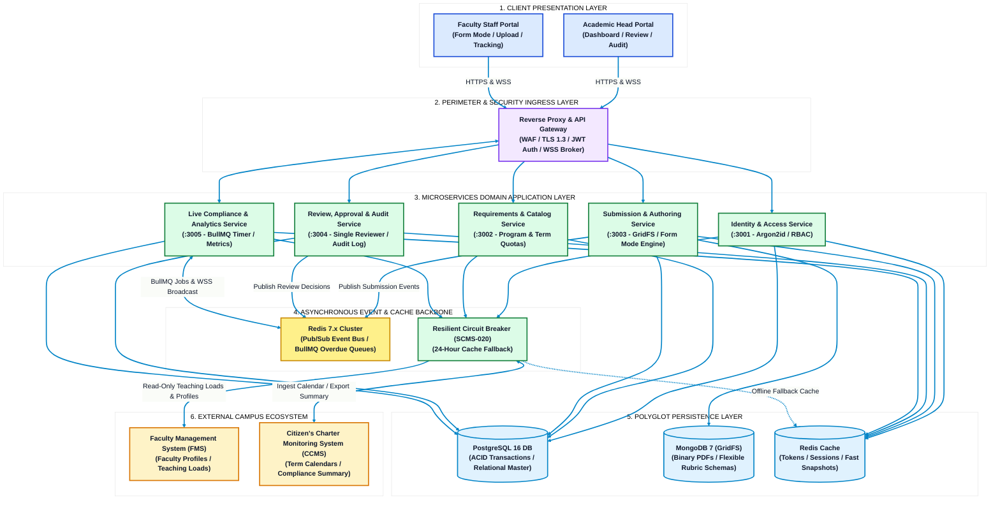
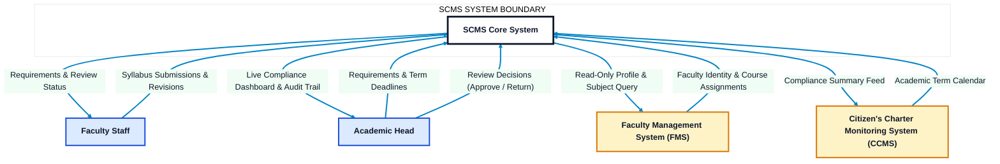
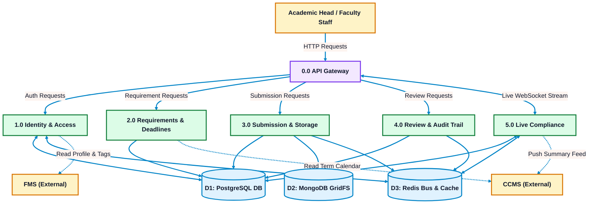
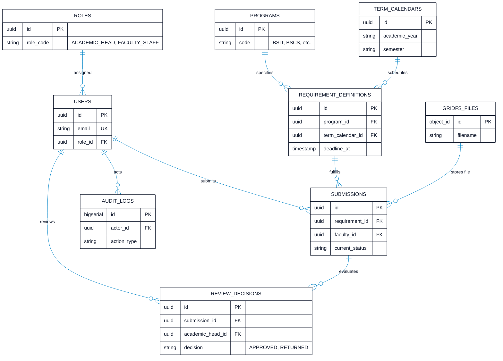
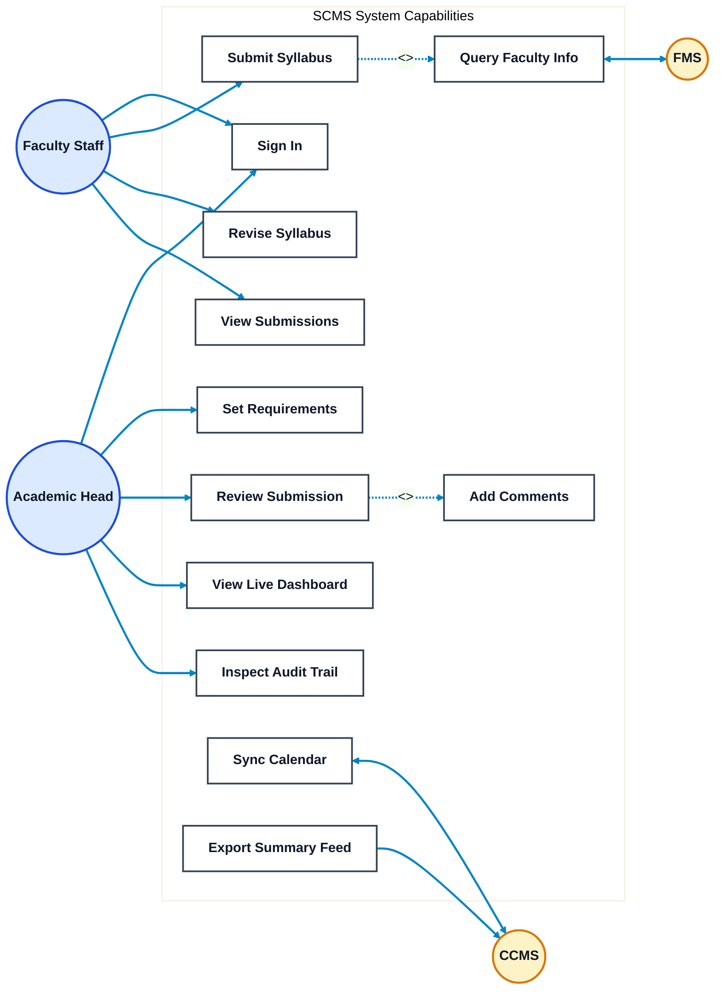
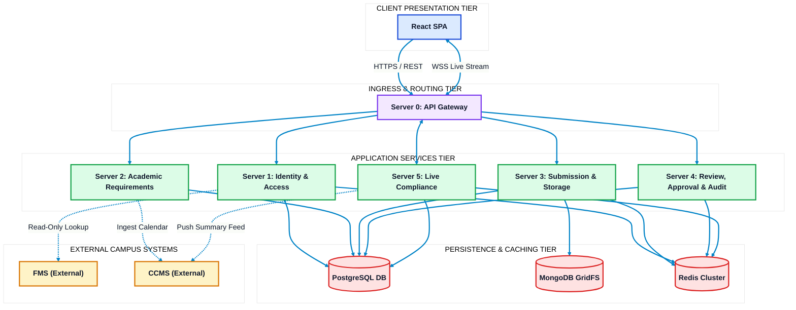
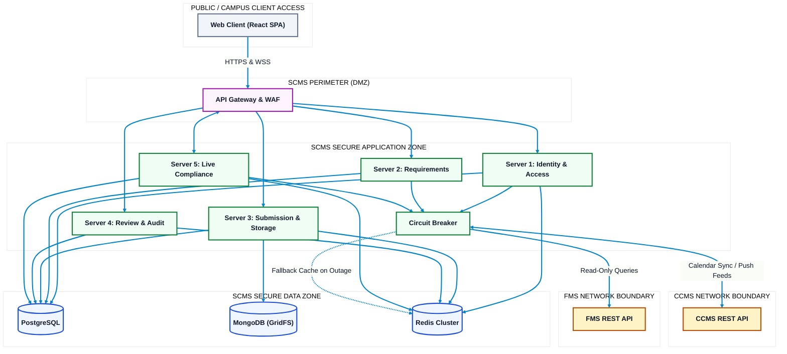

# Syllabus Compliance Monitoring System (SCMS)
## System Architecture & Technical Diagrams

**Institution:** Polytechnic University of the Philippines – Quezon City Campus (PUPQC)  
**Proposed by:** Donayre, Tablizo, Asusula, Bellen  
**Core Technologies:** React SPA, NestJS / Node.js Microservices, PostgreSQL, MongoDB (GridFS), Redis (Pub/Sub & Queues), WebSocket API Gateway  
**Operational Scope:** Exactly two user roles (**Academic Head** & **Faculty Staff**), real-time live compliance dashboard, direct compliance status model  
**Diagram Design Standard:** High-contrast, pure white background (`#FFFFFF`), bright visible connectors (`#0284C7`), and **clean minimalist boxes** (concise 1–3 word labels, no bullet lists inside boxes).

---

## 0. High-Level System Architecture (HLA)

The High-Level Architecture (HLA) provides an authoritative, end-to-end blueprint of the Syllabus Compliance Monitoring System (SCMS). It visualizes how presentation clients, ingress security perimeters, autonomous microservices, asynchronous messaging, polyglot persistence stores, and external campus partners interconnect.

### Comprehensive Architectural Explanation: High-Level Architecture (HLA)

#### 1. Strategic Role & System Mission
The Syllabus Compliance Monitoring System (SCMS / ACAS) serves as the central academic quality assurance engine for the Polytechnic University of the Philippines – Quezon City Campus (PUPQC). The platform enforces institutional compliance with Commission on Higher Education (CHED) Outcome-Based Education (OBE) policies by guaranteeing that all offered course sections possess officially approved, complete, and un-tampered syllabi before term deadlines.

#### 2. Core Architectural Principles
* **Decoupled Microservice Domains:** The backend is modularized into five domain-focused microservices governed by Single Responsibility and bounded context principles. Each service maintains autonomous logic and database interfaces.
* **Polyglot Persistence Strategy:** Rather than forcing all application data into a single paradigm, SCMS employs three specialized persistence technologies:
  1. *Relational PostgreSQL 16* for ACID transactions, role enforcement, status machines, and immutable audit ledgers.
  2. *Document MongoDB 7 (GridFS)* for chunked binary storage of syllabus files (PDF/DOCX) and dynamic JSON grading rubric structures.
  3. *In-Memory Redis 7* for sub-millisecond Pub/Sub event broadcasting, distributed BullMQ deadline evaluation queues, and integration caching.
* **Reactive Real-Time Event Bus:** Inter-service coordination and live UI updates utilize Redis Pub/Sub. When a submission or review action occurs, events are broadcast instantly via WebSockets to connected client dashboards, eliminating polling overhead.
* **Zero-Trust Perimeter & Ingress Security:** All incoming traffic enters through a unified Reverse Proxy / API Gateway enforcing Web Application Firewall (WAF) filtering, rate-limiting, TLS 1.3 termination, and HttpOnly JWT cookie verification before routing to internal services.
* **Fault-Tolerant Integration Isolation:** External systems (FMS and CCMS) are isolated through an automated Circuit Breaker (`SCMS-020`). If an external campus partner suffers an outage, SCMS degrades gracefully using a 24-hour cached snapshot stored in Redis, ensuring uninterrupted syllabus compilation and defense readiness.

#### 3. Layer-by-Layer Architectural Breakdown
1. **Client Presentation Layer:** Developed as a single-page application (React 18, TypeScript, TailwindCSS/Vanilla CSS). It delivers responsive, role-tailored workspaces for the Academic Head (compliance monitoring, approval panel, audit viewer) and Faculty Staff (syllabus file upload, interactive Form Mode compiler, revision tracking).
2. **Perimeter & Ingress Layer:** The API Gateway acts as the single point of entry. It terminates public HTTPS/WSS connections, executes rate limiting to prevent denial-of-service, validates cryptographically signed JWT credentials, and routes traffic over an isolated internal network.
3. **Microservices Application Layer:** Hosts the domain business logic across five dedicated services (`Server 1` to `Server 5`), each operating on dedicated container ports with isolated responsibilities.
4. **Messaging & Asynchronous Backbone:** Uses Redis 7 Pub/Sub to decouple write-heavy operational processes from read-heavy reporting dashboards. Background deadline evaluation jobs are processed by BullMQ workers running on cron intervals.
5. **Polyglot Persistence Layer:** Manages high-durability relational data in PostgreSQL, document/binary assets in MongoDB GridFS, and volatile cache/session states in Redis.
6. **External Campus Ecosystem Layer:** Connects to FMS for verified faculty identifiers and teaching load assignments, and CCMS for term calendar dates and compliance export feeds.

---

## 1. Context Diagram (System Context - Level 0)

The Context Diagram defines the operational boundary of SCMS. Exactly two user roles interface with the system: the **Academic Head** (single campus reviewer and administrator) and **Faculty Staff**, alongside external campus systems (**FMS** and **CCMS**).

### Comprehensive Architectural Explanation: Context Diagram (Level 0)

#### 1. Operational Purpose & Context Boundary
The Level 0 Context Diagram establishes the highest-level operational scope of the Syllabus Compliance Monitoring System (SCMS). It isolates SCMS as an autonomous black-box system, explicitly specifying the human actors permitted to interact with its interfaces and the external enterprise systems with which it exchanges data. This diagram serves as the contractual baseline for defining what belongs inside the system boundary versus what is delegated to external campus infrastructure.

#### 2. Human Actor Profiles & Authorization Boundaries
* **Academic Head (Single Campus Administrator & Reviewer):**
  * *Operational Scope:* Holds the exclusive administrative authority for the PUPQC branch.
  * *System Responsibilities:* Formulates syllabus compliance requirements per academic program (e.g., BSIT, BSCS), establishes strict statutory submission deadlines mapped to academic terms, evaluates incoming syllabus submissions, issues binding review decisions (`Approved` or `Returned` with specific remarks), monitors the real-time compliance status across all academic departments, and reviews the append-only audit trail for institutional accountability.
* **Faculty Staff (Course Instructors & Syllabus Drafters):**
  * *Operational Scope:* Encompasses all full-time, part-time, and temporary/contractual instructional personnel with active teaching assignments.
  * *System Responsibilities:* Inspects active program requirements, monitors upcoming submission deadlines, submits course syllabi via direct document upload (PDF/DOCX) or interactive OBE Form Mode, reviews constructive feedback on returned submissions, and uploads necessary revisions within the compliance window.

#### 3. External Campus Systems & Data Exchange Contracts
* **Faculty Management System (FMS):**
  * *System Role:* The external Single Source of Truth (SSOT) for verified faculty personnel records (employee IDs, official names, academic ranks, institutional emails, and office consultation hours) and semester teaching assignments (who is assigned to teach which section, time slot, and classroom).
  * *Data Exchange Protocol:* SCMS executes outbound, read-only RESTful queries against FMS to fetch instructor profiles and validate assigned subjects. FMS cannot independently create, update, or delete records in the SCMS catalog.
* **Citizen's Charter Monitoring System (CCMS):**
  * *System Role:* The university-wide compliance and citizen's charter oversight platform.
  * *Data Exchange Protocol:* CCMS supplies the official institutional academic term calendar (semester start dates, midterm evaluation periods, final term dates, and semester conclusion timestamps). In exchange, SCMS publishes periodic, aggregated compliance summary feeds (percentages of compliant, pending, returned, and overdue syllabi per department) to CCMS for executive university reporting.

#### 4. Inbound and Outbound Dataflow Specifications
* **Faculty Staff $leftrightarrow$ SCMS:**
  * *Inbound:* Syllabus document binaries (PDF/DOCX), structured OBE form inputs (ILOs, CLOs, 18-week OBTL plans), revision resubmissions, and acknowledgment receipts.
  * *Outbound:* Active requirement definitions, assigned submission deadlines, real-time review status indicators, and reviewer comments.
* **Academic Head $leftrightarrow$ SCMS:**
  * *Inbound:* Program requirement configurations, term calendar deadline rules, formal review decisions (`APPROVED` or `RETURNED`), and revision feedback comments.
  * *Outbound:* Aggregated live compliance metrics, department-level breakdown charts, submission queues, and tamper-evident audit logs.
* **FMS $leftrightarrow$ SCMS:**
  * *Inbound to SCMS:* Verified faculty profile payloads, academic ranks, official consultation hours, and finalized teaching assignment mappings.
  * *Outbound from SCMS:* Read-only query requests parameterized by faculty ID or course code.
* **CCMS $leftrightarrow$ SCMS:**
  * *Inbound to SCMS:* Official academic term calendar boundary dates.
  * *Outbound from SCMS:* Structured JSON compliance summaries and statutory compliance rate metrics.

#### 5. Scope Exclusions & System Boundaries
To maintain strict focus and high reliability, SCMS explicitly excludes the following capabilities:
* Student enrollment, section roster management, and grade encoding (owned by the University SIS).
* Physical classroom and laboratory facility scheduling (owned by FMS).
* Payroll computation and HR benefits tracking (owned by Central University HR).

---

## 2. Dataflow Diagram (Level 1 DFD)

The Level 1 Dataflow Diagram illustrates data movement between external entities, core operational processes, and polyglot data stores.

### Comprehensive Architectural Explanation: Level 1 Dataflow Diagram (DFD)

#### 1. Purpose & Dataflow Decomposition
The Level 1 Dataflow Diagram breaks down the monolithic system boundary into five distinct, specialized business logic processes. It explicitly traces how data originates from human users, passes through an ingress routing layer, undergoes transactional transformation, and persists into the appropriate storage paradigm (relational, document, or in-memory cache).

#### 2. Granular Operational Processes Breakdown
* **Process 0.0 (Ingress & Gateway Routing):**
  * Serves as the central traffic director. It inspects all inbound HTTP and WebSocket connections, verifies TLS certificates, enforces rate-limiting to mitigate abuse, validates incoming JWT tokens, and routes requests to the relevant internal operational process.
* **Process 1.0 (Identity & Access Management):**
  * *Functionality:* Authenticates users locally without external SSO dependencies using Argon2id cryptographic hashing. It evaluates assigned role permissions (`ACADEMIC_HEAD` or `FACULTY_STAFF`), issues signed JWT session cookies, and queries FMS via read-only REST endpoints to enrich local user sessions with verified faculty titles and consultation hours.
  * *Data Store Interactions:* Validates credentials against `D1 (PostgreSQL)`, maintains active session tokens and revocation blacklists in `D3 (Redis)`.
* **Process 2.0 (Requirements & Term Scheduling):**
  * *Functionality:* Governs academic program curriculum compliance. It enables the Academic Head to configure submission requirements, link them to specific academic programs, and ingest semester milestone dates from CCMS to establish statutory submission deadlines.
  * *Data Store Interactions:* Writes requirement schemas and term calendar records into `D1 (PostgreSQL)`.
* **Process 3.0 (Submission Ingestion & Content Storage):**
  * *Functionality:* Handles the intake of course syllabi submitted by faculty. In Upload Mode, it streams multipart binary files (PDF/DOCX), validates file headers and MIME types, chunks data into GridFS, and records submission metadata. In Form Mode, it compiles structured OBE form fields (ILOs, CLOs, OBTL plans) into standardized PDF documents. It updates the submission status from `NOT_SUBMITTED` to `SUBMITTED`.
  * *Data Store Interactions:* Persists submission metadata and status records in `D1 (PostgreSQL)`, writes binary chunks into `D2 (MongoDB GridFS)`, and emits state transition events onto `D3 (Redis Bus)`.
* **Process 4.0 (Review, Evaluation & Audit Trail):**
  * *Functionality:* Manages the single-reviewer approval workflow for the Academic Head. It processes formal evaluation actions (`APPROVED` or `RETURNED`), captures granular revision comments, updates compliance flags, and automatically generates an immutable audit record containing actor ID, IP address, timestamp, and before/after state diffs.
  * *Data Store Interactions:* Records review decisions, revision comments, and append-only audit rows in `D1 (PostgreSQL)`, and publishes review outcome events to `D3 (Redis Bus)`.
* **Process 5.0 (Live Compliance & Real-Time Monitoring):**
  * *Functionality:* Aggregates real-time compliance metrics across programs and departments. It maintains a persistent WebSocket connection to client dashboards for instant UI updates, runs automated BullMQ cron jobs to detect overdue submissions when term deadlines pass, and formats structured compliance summary feeds for CCMS.
  * *Data Store Interactions:* Reads status snapshots from `D1 (PostgreSQL)`, publishes/subscribes to WebSocket channels in `D3 (Redis Bus)`, and dispatches external feeds to CCMS.

#### 3. Polyglot Data Store Mechanics
* **D1: PostgreSQL Database:** The ACID transactional authority. It enforces strict referential integrity for user accounts, role definitions, program requirements, submissions state machine, review decisions, and immutable audit logs.
* **D2: MongoDB GridFS:** Dedicated binary storage engine. By offloading large PDF and DOCX syllabus files (often 2–15 MB each) into chunked collections (`fs.files` and `fs.chunks`), it prevents relational database bloat and ensures rapid database backups and index scans.
* **D3: Redis Cluster & In-Memory Bus:** The real-time backbone. Operates as an in-memory pub/sub message broker for live WebSocket notifications, a distributed job queue for BullMQ deadline timers, and an offline resilience cache for FMS faculty records.

#### 4. End-to-End Dataflow Execution Scenarios
* **Scenario A: Initial Syllabus Submission:**
  1. Faculty authenticates via `Process 1.0`.
  2. Faculty uploads syllabus via `Process 3.0`.
  3. Binary is streamed directly to `D2 (GridFS)`.
  4. Relational record is inserted into `D1 (PostgreSQL)` with `status = SUBMITTED`.
  5. An event `submission.created` is published to `D3 (Redis)`.
  6. `Process 5.0` picks up the event and broadcasts a live WebSocket notification to the Academic Head's dashboard.
* **Scenario B: Review & Approval:**
  1. Academic Head views the syllabus and records an `APPROVED` decision via `Process 4.0`.
  2. `Process 4.0` updates the submission row in `D1` to `status = APPROVED` and writes an immutable row into `audit_logs`.
  3. A `submission.approved` event is published to `D3`.
  4. `Process 5.0` recalculates compliance percentages and broadcasts updated counts to both the Academic Head and Faculty portals.

---

## 3. Entity Relationship Diagram (ERD)

The ERD models the relational and document data architecture. Boxes display essential primary keys (PK), foreign keys (FK), and core discriminators without visual clutter.

### Schema Field Reference Table

| Entity | Full Attribute Set | Purpose |
| :--- | :--- | :--- |
| **USERS** | `id`, `email`, `password_hash`, `first_name`, `last_name`, `fms_faculty_id`, `role_id`, `is_active`, `created_at` | Local user accounts (No SSO dependency) |
| **ROLES** | `id`, `role_code`, `description` | Strict two-role scope (`ACADEMIC_HEAD`, `FACULTY_STAFF`) |
| **PROGRAMS** | `id`, `code`, `name` | Academic programs (e.g., BSIT, BSCS, BSED, etc.) |
| **TERM_CALENDARS** | `id`, `academic_year`, `semester`, `start_date`, `end_date` | Term boundaries ingested from CCMS or set manually |
| **REQUIREMENT_DEFINITIONS** | `id`, `program_id`, `term_calendar_id`, `requirement_type`, `title`, `deadline_at`, `status` | Configured submission quotas and term deadlines |
| **SUBMISSIONS** | `id`, `requirement_id`, `faculty_id`, `subject_code`, `subject_title`, `current_status`, `is_overdue`, `mongo_file_id`, `submitted_at`, `approved_at` | Central state machine record tracking direct compliance |
| **REVIEW_DECISIONS** | `id`, `submission_id`, `academic_head_id`, `decision`, `comments`, `decided_at` | Single-reviewer evaluation record |
| **AUDIT_LOGS** | `id`, `actor_id`, `action_type`, `entity_name`, `entity_id`, `client_ip`, `created_at` | Append-only immutable log for all administrative and user actions |
| **GRIDFS_FILES** | `_id`, `filename`, `length`, `chunkSize`, `uploadDate`, `contentType` | Binary storage for syllabus PDFs and Word documents |

### Comprehensive Architectural Explanation: Entity Relationship Diagram (ERD)

#### 1. Purpose & Data Modeling Philosophy
The Entity Relationship Diagram (ERD) defines the logical and physical data model underlying the system. SCMS implements a hybrid polyglot architecture: structured, transactional, and relational data is strictly managed in PostgreSQL to guarantee ACID consistency and relational referential integrity, while large unstructured syllabus file binaries are stored in MongoDB GridFS to prevent relational database degradation.

#### 2. Relational Domain & Entity Breakdown (PostgreSQL)
* **`USERS` & `ROLES`:**
  * Enforces the strict two-role security architecture. The `ROLES` table contains exactly two predefined records: `ACADEMIC_HEAD` and `FACULTY_STAFF`.
  * The `USERS` table stores local identity credentials with Argon2id-hashed passwords (`password_hash`), precluding external SSO fragility. An optional `fms_faculty_id` provides a loose foreign reference to link local user accounts with external FMS instructor profiles without establishing direct cross-database foreign key constraints.
* **`PROGRAMS` & `TERM_CALENDARS`:**
  * `PROGRAMS` catalogs accredited degree offerings (e.g., BSIT, BSCS) across the campus.
  * `TERM_CALENDARS` establishes chronological term boundaries (e.g., A.Y. 2026–2027, 1st Semester), defining the valid temporal windows within which compliance is measured.
* **`REQUIREMENT_DEFINITIONS`:**
  * Serves as the relational bridge linking an academic program, an academic term, and a statutory deadline timestamp (`deadline_at`). It defines the exact compliance quota expected from faculty for a given semester.
* **`SUBMISSIONS` (Core Compliance State Machine):**
  * The central operational entity. Each record binds an assigned instructor (`faculty_id`) to a requirement (`requirement_id`) and subject (`subject_code`).
  * It maintains the deterministic compliance state machine (`current_status`: `NOT_SUBMITTED`, `SUBMITTED`, `UNDER_REVIEW`, `APPROVED`, `RETURNED`, `RESUBMITTED`), a boolean `is_overdue` flag evaluated by background workers, and an external reference pointer (`mongo_file_id`) to the stored binary document in GridFS.
* **`REVIEW_DECISIONS`:**
  * Captures the evaluation history conducted exclusively by the Academic Head. It records the evaluated submission (`submission_id`), the reviewer's identity (`academic_head_id`), the decision outcome (`APPROVED` or `RETURNED`), and detailed actionable feedback remarks (`comments`).
* **`AUDIT_LOGS`:**
  * An append-only, tamper-evident security ledger. It records every administrative and user operation (actor ID, action type, entity target, client IP, and UTC timestamp). Rows in this table cannot be updated or deleted, fulfilling ISO 27001 and RA 10173 compliance logging mandates.

#### 3. Document & Binary Store Domain (MongoDB GridFS)
* **`GRIDFS_FILES` (`fs.files` and `fs.chunks`):**
  * Course syllabi are binary objects often containing heavy embedded graphics, institutional seals, and formatting tables.
  * Rather than storing binary BLOBs inside PostgreSQL (which would cause database bloat, slow VACUUM operations, and degrade transaction throughput), files are streamed into MongoDB GridFS, divided into 255 KB chunks. The resulting 12-byte `ObjectId` is saved in the PostgreSQL `SUBMISSIONS.mongo_file_id` column as a lightweight cross-database foreign reference.

#### 4. Cardinality, Referential Integrity & Constraints
* **One-to-Many (`1:N`):**
  * One `ROLE` is assigned to many `USERS`.
  * One `USER` (Faculty) can submit many `SUBMISSIONS` (one per assigned subject section).
  * One `REQUIREMENT_DEFINITION` aggregates multiple `SUBMISSIONS` across all faculty teaching in that program.
  * One `SUBMISSION` can possess multiple historical `REVIEW_DECISIONS` (supporting revision loops if returned).
* **Foreign Key Cascade Policies:**
  * Deleting an academic program or requirement definition is blocked (`ON DELETE RESTRICT`) if active submissions exist.
  * User deletions are soft-deletes (`is_active = false`) to preserve historical audit trail integrity.

---

## 4. Use Case Diagram

The Use Case Diagram displays capabilities granted exclusively to the **Academic Head** and **Faculty Staff**, alongside external integration hooks.

### Comprehensive Architectural Explanation: Use Case Diagram

#### 1. Purpose & Functional Privilege Model
The Use Case Diagram specifies the complete functional capabilities of SCMS, clearly partitioning capabilities across the two human user roles and external system integrations. It guarantees that administrative powers (setting deadlines, formal evaluations, audit inspections) remain strictly isolated from authoring tasks (drafting, uploading, and revising syllabi).

#### 2. Actor Authorization Profiles
* **Faculty Staff (Author Actor):** Authorized to perform local sign-in (`UC1`), upload or compile course syllabi (`UC2`), resubmit revised syllabi in response to reviewer remarks (`UC3`), and track the compliance status and review history of their personal course submissions (`UC4`).
* **Academic Head (Reviewer & Administrator Actor):** Authorized to perform local administrative sign-in (`UC1`), define program-level syllabus quotas and statutory submission deadlines (`UC5`), evaluate submitted syllabi (`UC6`), append constructive revision comments (`UC7`), monitor campus-wide compliance statistics in real time (`UC8`), and inspect immutable audit logs for compliance verification (`UC9`).
* **External Systems (Automated API Actors):**
  * *FMS:* Provides verified faculty profiles and teaching load data (`UC10`).
  * *CCMS:* Ingests official academic term calendar boundaries (`UC11`) and consumes consolidated compliance feeds (`UC12`).

#### 3. Detailed Use Case Specifications (UC1 – UC12)
* **UC1: Sign In:** Validates user credentials against local Argon2id password hashes, checks active status, and sets secure HttpOnly JWT session cookies.
* **UC2: Submit Syllabus:** Enables faculty to fulfill an assigned requirement by either uploading a syllabus file (PDF/DOCX) or entering syllabus data via interactive Form Mode. Pre-populates verified faculty rank and consultation hours by including `UC10`.
* **UC3: Revise Syllabus:** Allows faculty to address returned review remarks by uploading an updated syllabus version, transitioning the status to `RESUBMITTED`.
* **UC4: View Submissions:** Displays personal submission history, current compliance statuses, and historical review remarks.
* **UC5: Set Requirements:** Allows the Academic Head to configure submission deadlines per degree program and term calendar.
* **UC6: Review Submission:** Displays submitted syllabus documents and metadata, allowing the Academic Head to execute an `APPROVE` or `RETURN` decision. Includes `UC7` for mandatory or optional comments.
* **UC7: Add Comments:** Captures specific, actionable revision feedback required when returning a syllabus.
* **UC8: View Live Dashboard:** Displays real-time aggregated compliance statistics, department breakdown charts, and overdue alerts via WebSocket live streams.
* **UC9: Inspect Audit Trail:** Grants the Academic Head read-only visibility into append-only system audit logs to verify user actions and compliance timelines.
* **UC10: Query Faculty Info:** Automated read-only lookup to FMS to verify instructor name, academic rank, and consultation schedule.
* **UC11: Sync Calendar:** Automated ingestion of official academic term start and end dates from CCMS.
* **UC12: Export Summary Feed:** Formats and transmits consolidated compliance rate summaries to CCMS for university-wide quality assurance reporting.

#### 4. Inclusion & Dependency Semantics
* **`UC6 <<include>> UC7`:** Whenever an Academic Head executes a review on a submission, the review workflow inherently incorporates the commenting facility. When returning a syllabus, adding comments is strictly enforced to provide faculty with actionable remediation guidelines.
* **`UC2 <<include>> UC10`:** When a faculty member initiates a syllabus submission, the system automatically triggers a background query to FMS to verify the instructor's profile and pre-populate syllabus header details, preventing manual data entry errors.

---

## 5. System Architecture Diagram (Multi-Tier)

This diagram details the physical and logical multi-tier microservices architecture. Boxes contain concise identifiers; tier details and responsibilities are described below.

### Microservices Responsibility Matrix

| Service | Host Port | Role & Key Responsibilities |
| :--- | :--- | :--- |
| **Server 0: API Gateway** | `:3000` | Ingress TLS termination, rate limiting, JWT token validation, WebSocket live compliance stream routing. |
| **Server 1: Identity & Access** | `:3001` | Local user authentication (Argon2id), RBAC enforcement for 2 roles, read-only FMS profile lookup adapter. |
| **Server 2: Requirements Service** | `:3002` | Program requirements definition, term deadlines management, CCMS academic calendar synchronization. |
| **Server 3: Submission & Storage** | `:3003` | Multipart file uploads (PDF/DOCX), MongoDB GridFS file handling, status transitions, Redis event publishing. |
| **Server 4: Review, Approval & Audit** | `:3004` | Academic Head single-reviewer workflow (Approve / Return), review comment storage, append-only immutable audit trail. |
| **Server 5: Live Compliance** | `:3005` | Real-time status counts aggregation, BullMQ overdue evaluation cron, CCMS summary feed dispatcher. |

### Comprehensive Architectural Explanation: Multi-Tier System Architecture

#### 1. Purpose & Multi-Tier Topology
The Multi-Tier System Architecture Diagram models the concrete physical and logical partitioning of SCMS. The architecture implements a Five-Tier enterprise topology designed to ensure horizontal scalability, zero-downtime deployments, strict isolation of concerns, and resilience against external network failures.

#### 2. Tier-by-Tier Architectural Breakdown
1. **Client Presentation Tier:**
   * Built as a modern Single Page Application (React 18, TypeScript, TailwindCSS/Vanilla CSS).
   * Renders modular views: Real-time Compliance Dashboard, Review Approval Panel, Submission Workspace, and interactive Form Mode OBE Syllabus Builder.
   * Maintains dual communication channels: standard REST/HTTPS for transactional commands and full-duplex WebSocket (`WSS`) for sub-second compliance status streaming.
2. **Ingress & Routing Gateway Tier (Server 0):**
   * Acts as the reverse proxy perimeter gateway running on port `:3000`.
   * Enforces TLS 1.3 encryption, terminates public SSL, mitigates volumetric and brute-force attacks via sliding-window rate limiters, validates cryptographically signed JWT cookies, and reverse-proxies requests to internal microservices over an isolated private container network.
3. **Application Services Tier (Servers 1 through 5):**
   * Encapsulates the domain business logic into five decoupled microservices operating on dedicated ports (`:3001` to `:3005`).
   * Each service is completely autonomous, packaging its own dependencies and data access layer, allowing independent scaling and isolated failure recovery.
4. **Persistence & In-Memory Tier:**
   * Combines relational PostgreSQL (ACID data authority), MongoDB GridFS (distributed binary file storage), and Redis (in-memory pub/sub broker, BullMQ queues, and fallback cache).
5. **External Campus Systems Tier:**
   * Represents external enterprise endpoints (FMS and CCMS) accessed exclusively through resilient HTTP clients equipped with timeout budgets and circuit breaker handlers.

#### 3. Inter-Service Communication Protocols
* **Synchronous REST / JSON:** Used for deterministic request-reply interactions (e.g., API Gateway routing an authentication request to Server 1, or retrieving a submission record from Server 3).
* **Asynchronous Redis Pub/Sub:** Used for decoupling domain events. When Server 3 (Submission) or Server 4 (Review) updates a record, it publishes an event onto the Redis bus. Server 5 (Live Compliance) consumes the event, recomputes departmental totals, and pushes the new metric to connected WebSockets without blocking the originating service.
* **Full-Duplex WebSockets:** Streams real-time compliance updates directly from Server 5 via Gateway Server 0 to client browsers, guaranteeing that the Academic Head's dashboard reflects incoming submissions and status changes instantly.

#### 4. High Availability, Scalability & Fault Isolation
* **Failure Isolation:** A memory leak or failure during file processing in Server 3 (Submission & Storage) does not impair authentication in Server 1 or compliance reporting in Server 5.
* **Horizontal Scalability:** Heavy file uploads in Server 3 can be scaled out with multiple container instances behind a round-robin load balancer without needing to scale the lightweight Requirements Service (Server 2).

---

## 6. Workflow Diagram (Submission Lifecycle & State Machine)

The Submission Lifecycle Diagram defines the deterministic transitions of a syllabus from publication through compliance, including the overdue trigger and revision cycles.

### Direct Compliance Status Definitions
* **`Not Submitted`:** Requirement has been published by the Academic Head; no file or form has been submitted yet by the faculty member.
* **`Submitted`:** Initial syllabus file or rubric form uploaded by Faculty Staff; awaiting evaluation.
* **`Under Review`:** Academic Head has opened the submission for review.
* **`Returned`:** Academic Head evaluated the submission, determined revisions are needed, and recorded constructive comments.
* **`Resubmitted`:** Faculty Staff addressed feedback and uploaded a revised syllabus version.
* **`Approved`:** Academic Head accepted the syllabus; submission is marked **Complied**.
* **`Overdue`:** The configured term deadline elapsed while the submission was not in an `Approved` state.

### Comprehensive Architectural Explanation: Submission Lifecycle & State Machine

#### 1. Purpose & Deterministic State Machine Model
The Submission Lifecycle Diagram defines the mathematical finite state machine (FSM) that governs every syllabus tracked by SCMS. The lifecycle models strict legal compliance rules: every course section assigned in an academic semester must follow an audited, deterministic path from initial publication by the Academic Head to final official compliance (`Approved`). Invalid transitions (such as transitioning directly from `Not Submitted` to `Approved` without review, or from `Approved` back to `Under Review`) are strictly prohibited at the database schema level.

#### 2. Comprehensive State Definitions & Lifecycle Progression
* **`NOT_SUBMITTED` (Initial Baseline):**
  * Automatically generated when a Requirement Definition is published for a program or when an FMS Teaching Assignment is ingested.
  * Represents an active compliance obligation assigned to a faculty member.
* **`SUBMITTED` (Pending Evaluation):**
  * Triggered when the faculty instructor uploads a valid syllabus document (PDF/DOCX) or completes all required fields in Form Mode.
  * Locks the submitted version and queues it for review by the Academic Head.
* **`UNDER_REVIEW` (Active Review):**
  * Triggered when the Academic Head opens the submission details to inspect the syllabus content, learning outcomes, and assessment rubrics.
  * Informs the faculty member that their document is currently undergoing formal evaluation.
* **`APPROVED` (Terminal Compliant State):**
  * Issued exclusively by the Academic Head when the syllabus satisfies all institutional OBE standards, ILO/PLO alignments, and university policies.
  * Transitions the submission into the **Complied** status, increments departmental compliance percentages, and locks the syllabus as the official curriculum blueprint for that semester.
* **`RETURNED` (Action Required):**
  * Issued by the Academic Head when deficiencies are identified (e.g., outdated grading percentages, missing consultation hours, or unaligned CLOs).
  * Requires mandatory constructive comments and re-opens the submission workspace for the faculty member.
* **`RESUBMITTED` (Revision Under Review):**
  * Triggered when the faculty member uploads a revised version addressing the Academic Head's feedback.
  * Routes the updated document back to the `UNDER_REVIEW` state while preserving the historical comment thread.
* **`OVERDUE` (Non-Blocking Compliance Flag):**
  * Triggered automatically by the system when the statutory term deadline (`deadline_at`) elapses and the submission is not in an `Approved` state.

#### 3. State Transition Triggers & Business Validation Rules
* **Strict Role Gating:** Only users with the `FACULTY_STAFF` role can trigger `NOT_SUBMITTED` $
ightarrow$ `SUBMITTED` and `RETURNED` $
ightarrow$ `RESUBMITTED`. Only the `ACADEMIC_HEAD` can execute the review transition into `APPROVED` or `RETURNED`.
* **Mandatory Remark Validation:** The system rejects any `RETURNED` transition if the `comments` payload is empty or shorter than 10 characters, ensuring that faculty receive actionable remediation guidance.

#### 4. Automated Overdue Evaluation Engine (BullMQ Cron)
* The overdue evaluation engine runs as an automated background worker powered by BullMQ and Redis.
* Rather than relying on human tracking, the worker executes a scheduled query comparing current UTC time against `REQUIREMENT_DEFINITIONS.deadline_at`.
* If a deadline has passed and `current_status != 'APPROVED'`, the worker sets `is_overdue = true` and emits an `overdue.triggered` event.
* **Non-Blocking Architecture:** Crucially, marking a submission as `Overdue` does **not** lock out the faculty member. Faculty can still upload and submit their syllabus; however, the submission will permanently carry an overdue audit flag and late submission indicator for institutional quality reviews.

#### 5. Revision & Resubmission Loops
* When a submission is `Returned`, previous file versions and reviewer comments are never overwritten.
* GridFS preserves previous file chunks under immutable `mongo_file_id` pointers, allowing both the Academic Head and the instructor to compare earlier drafts against revised uploads for transparent compliance verification.

---

## 7. Integrated Architecture Diagram (Network & Trust Boundaries)

This diagram outlines security zones, network perimeters, ingress trust boundaries, and circuit breaker protection between internal services and external campus APIs.

### Security & Perimeter Specifications
* **Perimeter Zone (DMZ):** Terminates HTTPS/TLS 1.3, executes Web Application Firewall (WAF) rule sets, mitigates brute-force attacks via rate limiters, and authenticates JWT cookie signatures before passing traffic inward.
* **Secure Application Zone:** Microservices run on an isolated container network. Services communicate through internal REST/gRPC endpoints and publish state events onto Redis.
* **Secure Data Zone:** PostgreSQL, MongoDB, and Redis are completely unexposed to public interfaces and accept connections exclusively from authenticated backend microservices.
* **External Integration Resilience:** The Circuit Breaker protects against FMS or CCMS latency or downtime. If an external system fails, cached data in Redis is served with graceful degradation flags.

### Comprehensive Architectural Explanation: Integrated Network & Trust Boundaries

#### 1. Purpose & Defense-in-Depth Security Model
The Integrated Architecture Diagram defines the comprehensive cybersecurity perimeter and physical/virtual network segmentation of SCMS. Designed according to defense-in-depth principles and the Philippine Data Privacy Act of 2012 (RA 10173), this model ensures that an attack or compromise at one layer (e.g., public web client) cannot compromise critical data assets (e.g., PostgreSQL credentials or MongoDB file chunks).

#### 2. Multi-Zone Network Segmentation
* **Zone 1: Public / Campus Client Access Zone:**
  * Represents untrusted networks, including public internet connections, campus Wi-Fi, and remote faculty workstations.
  * Direct access to internal microservices or databases is strictly prevented by firewall rules; all requests must enter via port 443 through the DMZ.
* **Zone 2: SCMS Perimeter Zone (DMZ):**
  * Houses the reverse proxy API Gateway and Web Application Firewall (WAF).
  * Enforces TLS 1.3 encryption, applies strict CORS policies, filters malicious payloads (SQL injection, XSS, directory traversal), terminates SSL sessions, and validates JWT authentication tokens stored in secure, HttpOnly, SameSite cookies.
* **Zone 3: SCMS Secure Application Zone:**
  * An isolated private virtual container network where the five application microservices (`Server 1` to `Server 5`) reside.
  * No service in this zone has a publicly routable IP address. Inter-service requests traverse a dedicated private bridge network.
* **Zone 4: SCMS Secure Data Zone:**
  * The innermost persistence zone hosting PostgreSQL 16, MongoDB 7, and the Redis Cluster.
  * Database listener ports (PostgreSQL `:5432`, MongoDB `:27017`, Redis `:6379`) are air-gapped from public interfaces and configured with strict IP whitelisting, accepting connections exclusively from application microservice containers within Zone 3.
* **Zone 5: External Campus Partner Networks (FMS & CCMS):**
  * Represents external institutional boundaries. Connections to FMS and CCMS APIs are routed through an egress Circuit Breaker proxy over mutual TLS (mTLS) or encrypted HTTPS, preventing external latency spikes from stalling internal operations.

#### 3. Security & Data Privacy Controls (RA 10173)
* **Local Password Security:** Passwords are cryptographically protected using the modern Argon2id hashing algorithm with dedicated per-user salt and high memory cost parameters, providing superior defense against GPU-accelerated cracking compared to legacy bcrypt or SHA-256.
* **Session Security:** Eliminates client-side localStorage token storage vulnerabilities. Authentication tokens are issued as cryptographically signed JWTs placed inside `HttpOnly`, `Secure`, `SameSite=Strict` cookies, completely neutralizing Cross-Site Scripting (XSS) token theft.
* **Data Minimization:** In strict adherence to RA 10173, SCMS queries only non-sensitive faculty metadata (name, institutional email, academic rank, consultation hours). Confidential HR details such as salary, personal phone numbers, and home addresses are never requested or stored.

#### 4. Resilient Circuit Breaker Architecture (`SCMS-020`)
* The integration gateway incorporates an automated three-state Circuit Breaker pattern (Closed, Open, Half-Open).
* **Normal State (Closed):** Outbound queries to FMS and CCMS proceed normally. Successful responses are asynchronously cached into Redis with a 24-hour Time-to-Live (TTL).
* **Outage State (Open):** If an external partner API fails (e.g., returns HTTP 5xx errors or times out over 3 consecutive calls), the Circuit Breaker trips to `Open`. Outbound requests are immediately intercepted without waiting for timeouts, and the system serves the cached Redis snapshot.
* **Graceful Degradation:** When operating on cached data, the UI displays an amber advisory badge: *"FMS temporarily unreachable; serving verified cached faculty profile."* This ensures that live thesis defense demonstrations or campus-wide syllabus compilation workflows are 100% resilient to third-party network failures.

---

## 8. Data Governance & Single Source of Truth (SSOT) Matrix (ACAS vs. FMS)

This matrix defines the clear system boundaries and legal authority over academic and operational data entities across PUP Quezon City Campus.

| Data Model / Catalog | Single Source of Truth (SSOT) | Why this system owns it |
| :--- | :---: | :--- |
| **Academic Programs & Curricula** *(e.g., BSIT, BSCS, BSIT-2024-Curriculum)* | **ACAS / SMS 🏛️** | **[Authoritative Degree Blueprints]:** ACAS tracks which programs exist, their curriculum versions, and mandatory degree requirements for graduation. |
| **Course Master Catalog** *(e.g., INTE 401, credit units, lecture/lab hours, facility tags)* | **ACAS / SMS 🏛️** | **[Official University Registry]:** ACAS is the master registry for all courses ("Course" officially replaces "Subject"). FMS queries this catalog to ensure legal subject assignment. |
| **Academic Terms** *(e.g., A.Y. 2026-2027 1st Semester, start/end dates)* | **ACAS / SMS 🏛️** | **[Statutory Compliance Windows]:** ACAS owns the semester timeline governing submission countdown timers and automated overdue evaluations. |
| **Stable Block Sections** *(e.g., BSIT 4-1, BSIT 4-2, cohort year 2023)* | **ACAS / SMS 🏛️** | **[Authoritative Section Registry]:** ACAS maintains stable cohort identity. Display labels may be updated without creating competing local masters in FMS. |
| **Syllabus Content, Policies & Signatories** *(CLOs, 18-week OBTL plans, 70/30 grading, 4-level approval)* | **ACAS / SMS 🏛️** | **[Academic Quality & Accreditation]:** ACAS guarantees syllabus integrity, preventing tampering with university-approved learning outcomes and policies. |
| **Faculty Profiles (Minimal Subset)** *(faculty_id, display_name, institutional_email, conditional rank/hours)* | **FMS 👥** | **[HR & Faculty Records]:** FMS manages faculty onboarding and consultation schedules. ACAS queries this via read-only endpoints (salary, home address, and HR evaluations excluded under RA 10173). |
| **Teaching Assignments** *(Human-approved load allocations & finalized meeting times/rooms)* | **FMS 👥** | **[Semester Timetable Operations]:** FMS links instructors to SMS-owned Course, Term, and Block Section IDs. Human approval triggers SMS tracking before timetable finalization. |
| **Physical Room & Space Catalog** *(Buildings, rooms, capacities, lab setups)* | **FMS 👥** | **[Physical Asset Scheduling]:** FMS schedules classrooms and laboratories to prevent double-booking. ACAS only consumes final room labels for syllabus headers. |

> **Key Integration Boundaries Confirmed (October 16, 2026):**  
> 1. **Enrolment Management Relief:** FMS is completely relieved of student enrollment headcounts, class sizes, or student rosters. ACAS/SMS monitors compliance strictly at the section level (`BSIT 4-1`).  
> 2. **CCCMS Boundary:** Calendar-only integration for statutory semester dates and intraday class suspensions. Office working hours do NOT overwrite academic teaching schedules.  
> 3. **Joint Acceptance Gate:** Integration readiness is formally verified against **Scenarios J1 through J16** across two complete rehearsals prior to defense.

---

## 9. Official PUPQC Outcomes-Based Course Syllabus Specification

Based on the official PUP Quezon City Campus syllabus template (Reference: `INTE 401 - Information Assurance and Security 2`), the syllabus entity in ACAS/SCMS models the following hierarchical schema:

### 1. Course Information (Course Master Metadata)
* **Course Code:** `INTE 401`
* **Course Title:** `INFORMATION ASSURANCE AND SECURITY 2`
* **Course Credit Units:** `3 Units`
* **Pre-Requisites:** `INTE 302 – Information Assurance and Security 1` | **Co-Requisites:** `None`
* **Course Description:** Exploration of operational, technical, and managerial pillars of information security (DevSecOps, Cloud Security, Digital Forensics, GRC).
* **Campus & University Mandates:**
  * **University Vision:** *"A Leading Comprehensive Polytechnic University in Asia"*
  * **University Mission:** *"Advance an inclusive, equitable, and globally relevant polytechnic education towards national development."*
  * **Quality Policy Statement:** Commitment to inclusive and equitable quality education and continuous improvement.
  * **Campus Goals:** 1. Academic Excellence, 2. Robust Research & Innovation, 3. Community Extension & Linkages, 4. Strategic Institutional Development.

### 2. Learning Outcomes Hierarchy & Alignment Matrix
* **Institutional Learning Outcomes (ILOs 1 to 9):**
  1. Critical & Creative Thinking, 2. Effective Communication, 3. Strong Service Orientation, 4. Responsible Tech Use, 5. Lifelong Learning, 6. Leadership Skills, 7. Personal & Professional Ethics, 8. Resilience & Agility, 9. National & Global Responsiveness.
* **Program Learning Outcomes (PLOs 1 to 12 - CMO No. 25, Series of 2017):**
  * BSIT program competencies aligned to university ILOs.
* **Course Learning Outcomes (CLOs) & Mapping:**
  * Each CLO maps to PLOs with competency levels:
    * **L** = Learned (Knowledge acquired)
    * **P** = Practiced (Skills applied)
    * **O** = Opportunity to demonstrate (Synthesis / Capstone)

---

## 10. Grading System, Assessment Rubrics & Institutional Signatory Block

Based on the final approved PUPQC syllabus specification, the following structures govern evaluation and formal endorsement:

### 1. Course Requirements (Mapped to CLOs 1 to 7)
* **Classroom Participation (Recitation):** Applies to CLO 1-7
* **Class Activities & Assignments:** Submitted on time via Google Classroom (Applies to CLO 1-7)
* **Final Capstone Project:** Information Security Management Plan based on ISO 27001/ISMS standards (Applies to CLO 1-7)

### 2. Official 70/30 Outcomes-Based Grading System

$$\text{Final Grade} = \frac{\text{Midterm Grade} + \text{Final Term Grade}}{2}$$

| Evaluation Period | Component | Weight | Detailed Sub-Weights |
| :--- | :--- | :---: | :--- |
| **1st Grading (Midterm)** | **Class Standing** | **70%** | • Class Participation: 10% • Attendance: 10% • Assignments: 10% • Quizzes: 20% • Written Activities: 20% |
| | **Midterm Examination** | **30%** | Conduct of Exam (TOS / Rubric aligned) |
| | **Midterm Total** | **100%** | |
| **2nd Grading (Finals)** | **Class Standing** | **70%** | • Class Participation: 5% • Attendance: 10% • Assignments: 10% • Quizzes: 10% • Written Activities: 10% • **Final Project:** 25% |
| | **Final Examination** | **30%** | Final Project Defense / Exam |
| | **Finals Total** | **100%** | |

### 3. Assessment Rubrics (4-Tier Competency Scale)
* **Exemplary / Excellent:** 5 pts (100%)
* **Accomplished / Good:** 4 pts (80%)
* **Developing / Requires Improvement:** 3 pts (60%)
* **Deficient / Poor:** 2 pts (40%)
* Evaluated against: **Originality & Creativity** and **Significance to the Topic**.

### 4. Classroom & Delivery Policies (Preset Defaults in Form Mode)
* **Face-to-Face Delivery:** 15-minute attendance grace period, active participation, punctuality, and 5% deduction per day for late assignment submissions.
* **Flexible Learning & Teaching Activities (FLTAs):**
  * **Synchronous:** MS Teams online sessions with camera/mic preparedness.
  * **Asynchronous:** Google Classroom modular self-study, milestone tracking, and consultation via Google Classroom/Viber.

### 5. Institutional Signatory & Approval Hierarchy
When exporting the finalized syllabus or displaying official review status, the system recognizes the university endorsement sequence:
1. **Prepared by:** `Faculty / Course Instructor` *(Submits syllabus in SCMS)*
2. **Reviewed and checked by:** `Academic Head` *(Primary reviewer & single-level approval in SCMS)*
3. **Recommending Approval:** `Campus Director` *(Institutional Executive)*
4. **Approved by:** `Vice President for Campuses` *(Executive Endorsement)*

