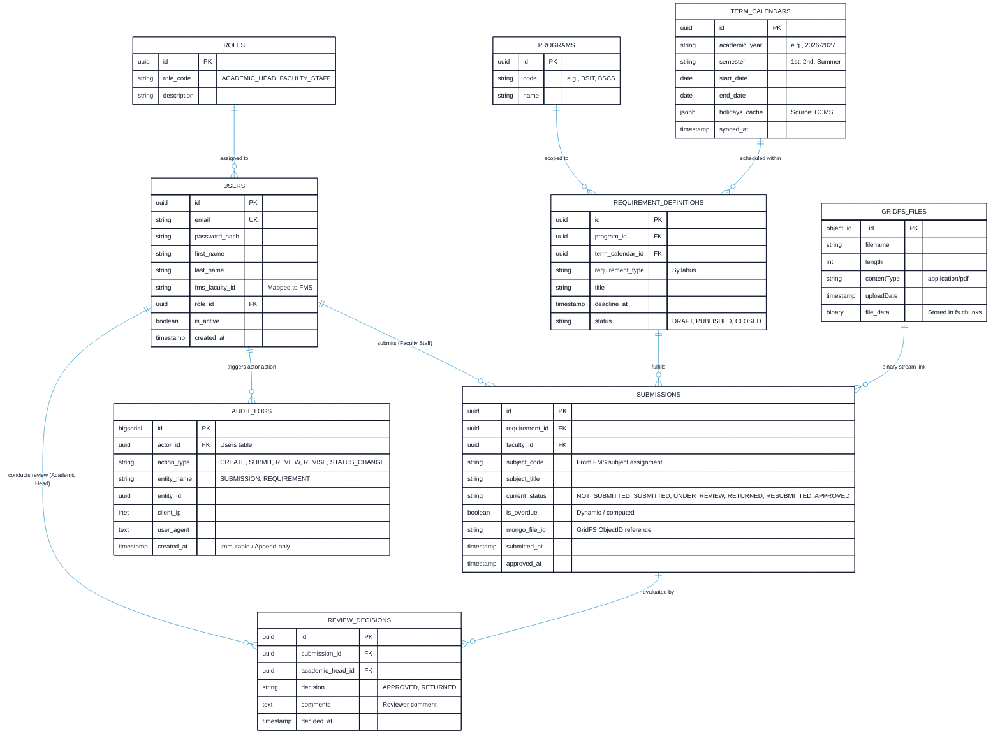
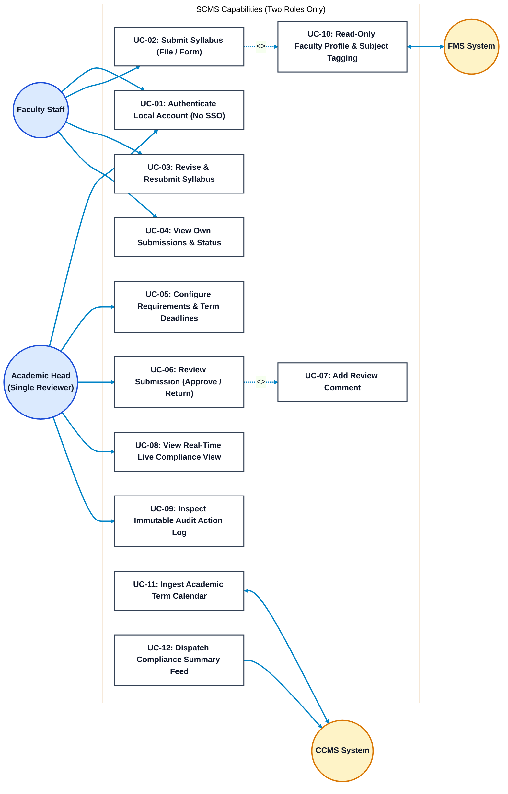
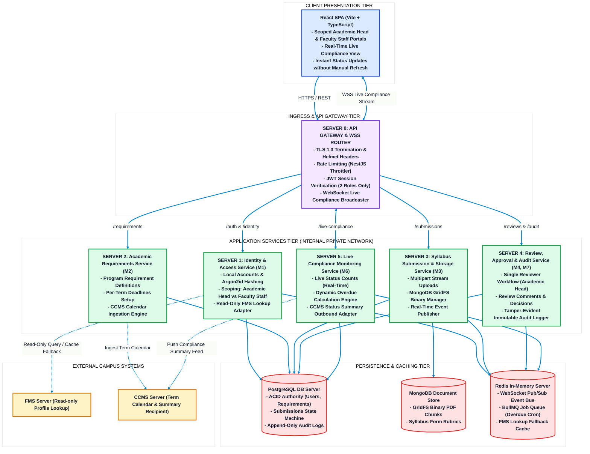
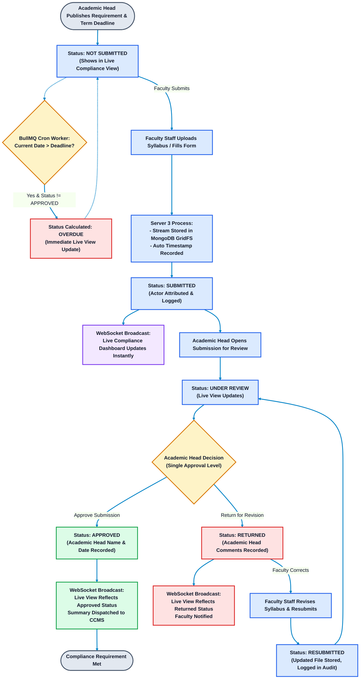

# Syllabus Compliance Monitoring System (SCMS)
## System Architecture & Technical Diagrams

**Institution:** Polytechnic University of the Philippines — Quezon City Campus (PUPQC)  
**Proposed by:** Donayre, Tablizo, Asusula, Bellen  
**Core Technologies:** React SPA (Tailwind + Radix + MUI), NestJS Microservices, Node.js, PostgreSQL (Relational Core), MongoDB (GridFS Storage), Redis (Pub/Sub & BullMQ), WebSocket Gateway.  
**Operational Scope:** Exactly two user roles (**Academic Head** & **Faculty Staff**), real-time live compliance updates, direct compliance status model.

---

## 1. Context Diagram (System Context - Level 0)

The Context Diagram defines the operational perimeter of SCMS. Exactly two user roles interface with the system: the **Academic Head** (single campus reviewer) and **Faculty Staff**, alongside external campus systems (**FMS** and **CCMS**).

```mermaid
%%{init: {'theme': 'base', 'themeVariables': { 'darkMode': false, 'background': '#FFFFFF', 'primaryColor': '#EFF6FF', 'primaryTextColor': '#0F172A', 'primaryBorderColor': '#1E293B', 'lineColor': '#0284C7', 'secondaryColor': '#F0FDF4', 'tertiaryColor': '#FFFFFF' }}}%%
flowchart TB
    classDef actorNode fill:#DBEAFE,stroke:#1D4ED8,stroke-width:2.5px,color:#0F172A,font-weight:bold;
    classDef systemNode fill:#FFFFFF,stroke:#0F172A,stroke-width:3.5px,color:#0F172A,font-weight:bold;
    classDef extSysNode fill:#FEF3C7,stroke:#D97706,stroke-width:2.5px,color:#0F172A,font-weight:bold;

    subgraph Perimeter [" SCMS SYSTEM BOUNDARY "]
        SCMS["SCMS CORE SYSTEM\n(API Gateway & 5 Dedicated Backend Microservices)\n[PostgreSQL + MongoDB GridFS + Redis]"]:::systemNode
    end

    %% Two Human Roles Only
    Faculty["Faculty Staff"]:::actorNode
    AcadHead["Academic Head\n(Single Campus Reviewer)"]:::actorNode

    %% External Campus Systems
    FMS["Faculty Management System (FMS)\n[Read-Only Profiles & Subject Tagging]"]:::extSysNode
    CCMS["Citizen's Charter Monitoring System (CCMS)\n[Term Calendar Source & Summary Recipient]"]:::extSysNode

    %% Interactions - Faculty Staff
    Faculty -- "1. Syllabus Document / Form Submission" --> SCMS
    Faculty -- "2. Revised Syllabus Submission" --> SCMS
    SCMS -- "3. Assigned Requirements, Status & Review Comments" --> Faculty

    %% Interactions - Academic Head
    AcadHead -- "4. Requirement Setup & Term Deadlines" --> SCMS
    AcadHead -- "5. Review Decisions (Approve / Return + Comments)" --> SCMS
    SCMS -- "6. Live Compliance View (Real-Time Auto-Updating)" --> AcadHead
    SCMS -- "7. Tamper-Evident Action Audit Trail" --> AcadHead

    %% Interactions - FMS
    SCMS -- "8. Read-Only Faculty Profile & Subject Tagging Queries" --> FMS
    FMS -- "9. Profile Identity & Subject Assignment Data" --> SCMS

    %% Interactions - CCMS
    CCMS -- "10. Official Term Dates & Campus Holidays" --> SCMS
    SCMS -- "11. Consolidated Compliance Status Summary Feed" --> CCMS
    CCMS -. "12. Complaint Case Referrals (To Be Confirmed)" .-> SCMS

    linkStyle default stroke:#0284C7,stroke-width:2.5px;
```



---

## 2. Dataflow Diagram (Level 1 DFD)

This diagram details internal data flows between the API Gateway, five specialized microservice processes, polyglot data stores, and the real-time WebSocket live compliance channel.

```mermaid
%%{init: {'theme': 'base', 'themeVariables': { 'darkMode': false, 'background': '#FFFFFF', 'primaryColor': '#F0FDF4', 'primaryTextColor': '#0F172A', 'primaryBorderColor': '#1E293B', 'lineColor': '#0284C7' }}}%%
flowchart TB
    classDef procNode fill:#DCFCE7,stroke:#15803D,stroke-width:2.5px,color:#0F172A,font-weight:bold;
    classDef storeNode fill:#E0F2FE,stroke:#0284C7,stroke-width:2.5px,color:#0F172A,font-weight:bold;
    classDef extNode fill:#FEF3C7,stroke:#D97706,stroke-width:2.5px,color:#0F172A,font-weight:bold;
    classDef gateNode fill:#F3E8FF,stroke:#7C3AED,stroke-width:2.5px,color:#0F172A,font-weight:bold;

    User["Academic Head / Faculty Staff"]:::extNode
    Gateway["0.0 Server 0: API Gateway & WebSocket Router\n(Rate Limiting, JWT Validation, Live Broadcasts)"]:::gateNode

    %% Processes
    P1["1.0 Server 1: Identity & Access\n(Local Auth, 2 Roles, FMS Lookup)"]:::procNode
    P2["2.0 Server 2: Academic Requirements\n(Program Requirements & Term Deadlines)"]:::procNode
    P3["3.0 Server 3: Syllabus Submission & Storage\n(Multipart Ingestion, GridFS Binary Store)"]:::procNode
    P4["4.0 Server 4: Review, Approval & Audit\n(Single-Level Review, Comments, Audit Trail)"]:::procNode
    P5["5.0 Server 5: Live Compliance Monitoring\n(Real-Time Counts, Overdue Recalc, CCMS Feed)"]:::procNode

    %% Data Stores
    D1[("D1: PostgreSQL Relational DB\n(ACID State, Accounts, Requirements, Audit)")]:::storeNode
    D2[("D2: MongoDB Document & GridFS\n(Binary PDFs, Rubric Forms)")]:::storeNode
    D3[("D3: Redis Cache & Event Bus\n(Pub/Sub Live Updates, FMS Cache Fallback)")]:::storeNode

    %% External Systems
    FMS_Ext["FMS (External)"]:::extNode
    CCMS_Ext["CCMS (External)"]:::extNode

    %% Connections
    User -->|HTTP Requests / REST| Gateway
    Gateway -->|Auth Routes| P1
    Gateway -->|Requirement Routes| P2
    Gateway -->|Upload/Form Routes| P3
    Gateway -->|Review Routes| P4
    Gateway <-->|Live Compliance WebSocket Stream| P5

    P1 <-->|Verify Credentials (2 Roles)| D1
    P1 <-->|Cached FMS Lookups| D3
    P1 -.->|Read-Only Query| FMS_Ext

    P2 -->|Save Requirements & Deadlines| D1
    P2 -.->|Ingest Term Calendar| CCMS_Ext

    P3 -->|Save Submission Status| D1
    P3 -->|Store Binary Stream in GridFS| D2
    P3 -->|Emit Status Event| D3

    P4 -->|Update Status & Append Audit Trail| D1
    P4 -->|Emit Review Decision Event| D3

    P5 <-->|Read Current Status Counts| D1
    P5 <-->|Pub/Sub Event Broadcasts| D3
    P5 -.->|Push Compliance Summary Feed| CCMS_Ext

    linkStyle default stroke:#0284C7,stroke-width:2.5px;
```

---

## 3. Entity Relationship Diagram (ERD - Polyglot Persistence)

SCMS maintains strict relational records in **PostgreSQL** (Users, 2 Roles, Programs, Requirements, Submissions, Decisions, Audit Trail) and offloads binary files to **MongoDB GridFS**.



---

## 4. Use Case Diagram

This diagram maps all interactions across the **two user roles** and external systems.



---

## 5. System Architecture Diagram (API Gateway + 5 Microservices + Real-Time Live Bus)

This diagram details the physical and logical multi-server architecture.



---

## 6. Workflow Diagram (Submission Lifecycle & Live View Synchronization)

This diagram details the lifecycle of a submission and its **instant reflection in the live compliance view**.



---

## 7. Integrated Architecture Diagram (Network, Trust & Security Boundaries)

This diagram details network segmentation, trust boundaries, and resilience mechanisms across **SCMS, FMS, and CCMS**.

```mermaid
%%{init: {'theme': 'base', 'themeVariables': { 'darkMode': false, 'background': '#FFFFFF', 'primaryColor': '#F8FAFC', 'primaryTextColor': '#0F172A', 'primaryBorderColor': '#1E293B', 'lineColor': '#0284C7' }}}%%
flowchart TB
    classDef client fill:#F1F5F9,stroke:#64748B,stroke-width:2.5px,color:#0F172A,font-weight:bold;
    classDef dmz fill:#FDF4FF,stroke:#A21CAF,stroke-width:2.5px,color:#0F172A,font-weight:bold;
    classDef app fill:#F0FDF4,stroke:#15803D,stroke-width:2.5px,color:#0F172A,font-weight:bold;
    classDef data fill:#EFF6FF,stroke:#1D4ED8,stroke-width:2.5px,color:#0F172A,font-weight:bold;
    classDef ext fill:#FEF3C7,stroke:#B45309,stroke-width:2.5px,color:#0F172A,font-weight:bold;

    subgraph Zone_Public [" PUBLIC / CAMPUS CLIENT ACCESS (UNTRUSTED) "]
        Clients["Web Browsers (Academic Head & Faculty Staff)\n- HTTPS over TLS 1.3 (Port 443)\n- WSS Real-Time Live View Channels\n- HttpOnly, SameSite=Strict Secure Cookies"]:::client
    end

    subgraph Zone_SCMS_DMZ [" SCMS PERIMETER & INGRESS (DMZ) "]
        WAF_Gateway["Server 0: API Gateway & WebSocket Router\n- Strict IP Rate Limiting (NestJS Throttler)\n- OWASP Top 10 Request Filtering\n- CORS Whitelist (SCMS Domain Only)\n- Max 10MB Multipart File Payload Limiter"]:::dmz
    end

    subgraph Zone_SCMS_Private [" SCMS SECURE APPLICATION ZONE (PRIVATE NETWORK) "]
        S1["Server 1: Identity & Access Service (2 Roles)"]:::app
        S2["Server 2: Academic Requirements Service"]:::app
        S3["Server 3: Syllabus Submission & GridFS Storage Service"]:::app
        S4["Server 4: Review, Approval & Audit Trail Service"]:::app
        S5["Server 5: Live Compliance Monitoring Service"]:::app
        CircuitBreaker["Resilience Circuit Breaker\n(Serves cached Redis reference data if FMS/CCMS is offline)"]:::app
    end

    subgraph Zone_SCMS_Data [" SCMS SECURE DATA ZONE (NO DIRECT INTERNET ACCESS) "]
        PG_DB[("PostgreSQL Relational DB\n- Scoped App User: DML Only\n- AES-256 Storage Encryption\n- Append-Only Audit Logs")]:::data
        Mongo_DB[("MongoDB Cluster\n- GridFS Binary Store\n- TLS Authenticated Mongoose Connections\n- Current Syllabus Rubrics")]:::data
        Redis_Store[("Redis Cluster\n- Pub/Sub Real-Time Event Bus\n- In-Memory FMS Lookup Fallback Cache")]:::data
    end

    subgraph Zone_External_FMS [" FMS NETWORK BOUNDARY (PUP FMS ZONE) "]
        FMS_API["FMS REST API Endpoint\n- Read-Only API Token Authorization\n- Data Contract: Name, College, Subject Tagging\n- ZERO Credential / Session Sharing"]:::ext
    end

    subgraph Zone_External_CCMS [" CCMS NETWORK BOUNDARY (PUP CCMS ZONE) "]
        CCMS_API["CCMS REST API & Ingestion Webhook\n- Inbound: Academic Calendar & Holidays\n- Outbound: Push Compliance Status Summary\n- Signed HMAC Signature Payloads"]:::ext
    end

    %% Network Connections
    Clients -->|HTTPS Port 443 & WSS| WAF_Gateway
    WAF_Gateway -->|Internal mTLS / Private Routing| S1
    WAF_Gateway -->|Internal mTLS / Private Routing| S2
    WAF_Gateway -->|Internal mTLS / Private Routing| S3
    WAF_Gateway -->|Internal mTLS / Private Routing| S4
    WAF_Gateway <-->|Internal WebSocket Bus| S5

    S1 --> PG_DB
    S1 --> Redis_Store
    S2 --> PG_DB
    S3 --> PG_DB
    S3 --> Mongo_DB
    S3 --> Redis_Store
    S4 --> PG_DB
    S4 --> Redis_Store
    S5 --> PG_DB
    S5 --> Redis_Store

    S1 --> CircuitBreaker
    S2 --> CircuitBreaker
    S5 --> CircuitBreaker

    CircuitBreaker -->|Read-Only Lookup (mTLS / API Key)| FMS_API
    CircuitBreaker <-->|Calendar Query / Event Push (Signed HMAC)| CCMS_API
    CircuitBreaker -.->|On Outage: Read Cached Reference Data| Redis_Store

    linkStyle default stroke:#0284C7,stroke-width:2.5px;
```
