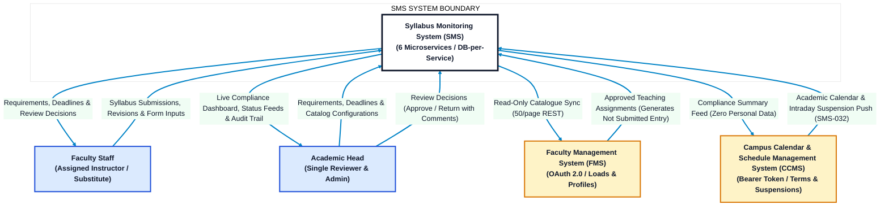
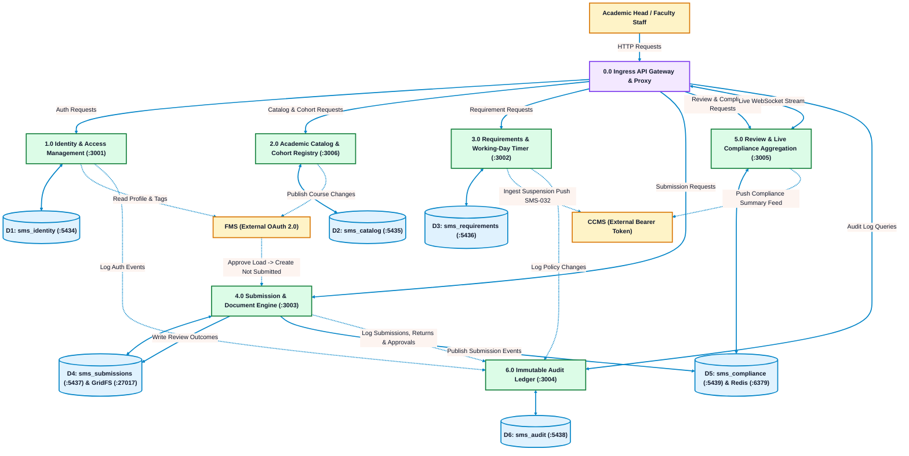
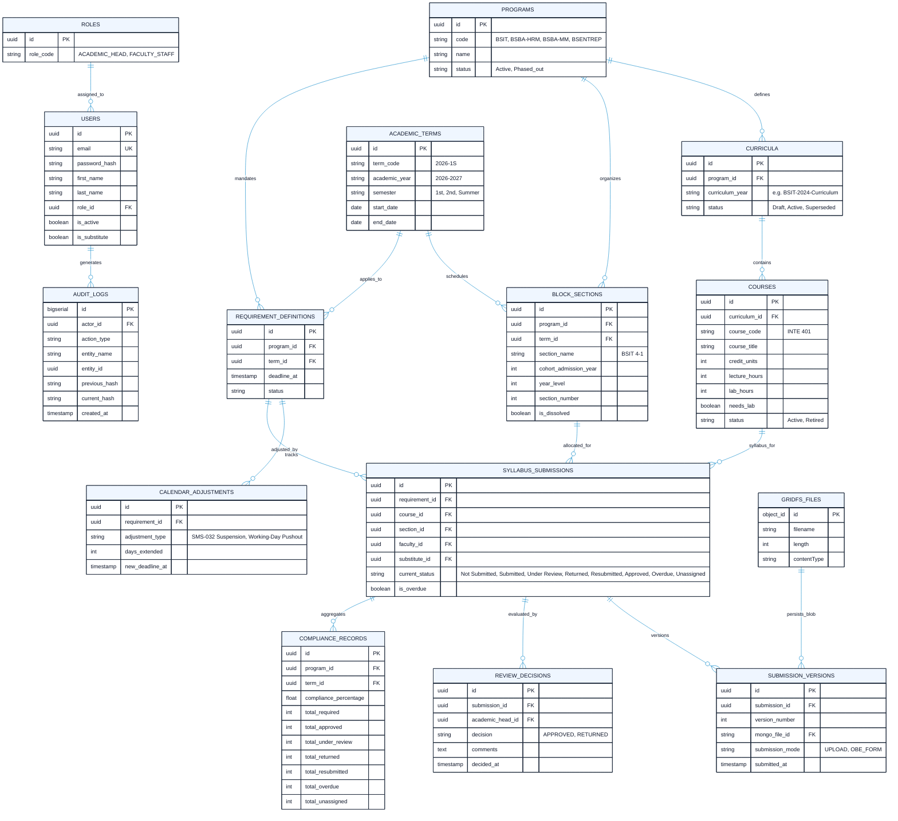
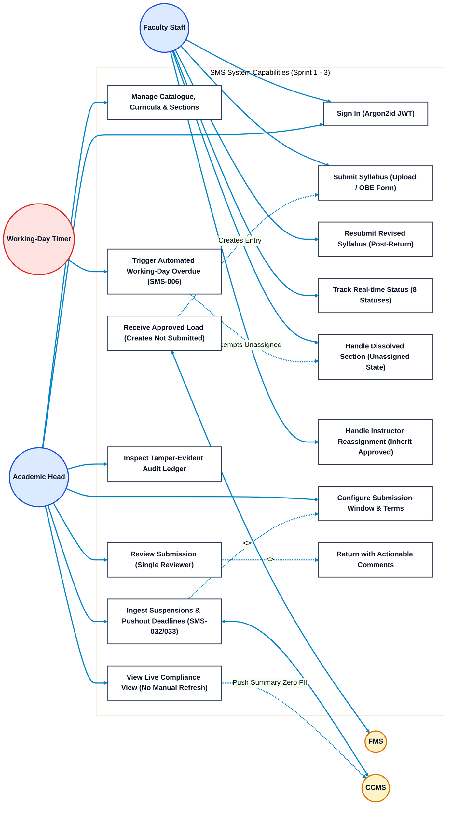
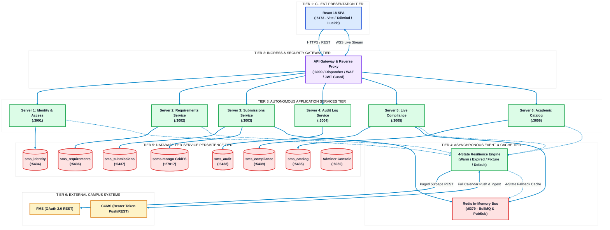
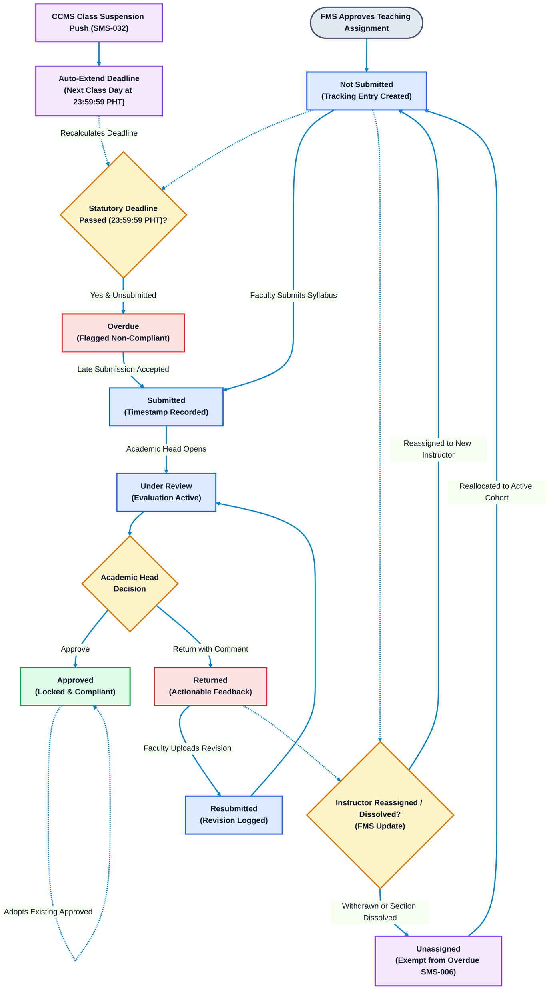

# Syllabus Monitoring System (SMS / ACAS)
## System Architecture & Technical Diagrams

**Institution:** Polytechnic University of the Philippines – Quezon City Campus (PUPQC)  
**Proposed by:** Donayre, Tablizo, Asusula, Bellen  
**Core Technologies:** React 18 SPA, NestJS / Node.js Microservices, PostgreSQL (Database-per-Service), MongoDB (GridFS), Redis (In-Memory Pub/Sub & Queues), WebSocket API Gateway  
**Operational Scope:** Exactly two human user roles (**Academic Head** & **Faculty Staff**), real-time live compliance dashboard, 8-state deterministic submission lifecycle  
**Regulatory Baseline:** PUP Faculty Manual (Section C: Syllabus, p. 52), ISO 27001, and Republic Act No. 10173 (Data Privacy Act of 2012)  
**Diagram Design Standard:** High-contrast, pure white background (`#FFFFFF`), bright visible connectors (`#0284C7`), and **clean minimalist boxes** (concise 1–3 word labels, no bullet lists inside boxes).

---

## 0. High-Level System Architecture (HLA)

The High-Level Architecture (HLA) provides an authoritative, end-to-end blueprint of the Syllabus Monitoring System (SMS). It visualizes how presentation clients, ingress security perimeters, 6 autonomous domain microservices, asynchronous messaging, polyglot persistence stores (database-per-service pattern), and external campus partners (FMS and CCMS) interconnect under four defined data resilience states.

```mermaid
%%{init: {'theme': 'base', 'themeVariables': { 'darkMode': false, 'background': '#FFFFFF', 'primaryColor': '#F8FAFC', 'primaryTextColor': '#0F172A', 'primaryBorderColor': '#1E293B', 'lineColor': '#0284C7' }}}%%
flowchart TB
    classDef clientNode fill:#DBEAFE,stroke:#1D4ED8,stroke-width:2.5px,color:#0F172A,font-weight:bold;
    classDef gateNode fill:#F3E8FF,stroke:#7C3AED,stroke-width:2.5px,color:#0F172A,font-weight:bold;
    classDef coreNode fill:#DCFCE7,stroke:#15803D,stroke-width:2.5px,color:#0F172A,font-weight:bold;
    classDef busNode fill:#FEF08A,stroke:#CA8A04,stroke-width:2.5px,color:#0F172A,font-weight:bold;
    classDef dataNode fill:#E0F2FE,stroke:#0284C7,stroke-width:2.5px,color:#0F172A,font-weight:bold;
    classDef extNode fill:#FEF3C7,stroke:#D97706,stroke-width:2.5px,color:#0F172A,font-weight:bold;

    subgraph Client_Layer [" 1. CLIENT PRESENTATION LAYER "]
        AcadHeadUI["Academic Head Portal<br/>(Dashboard / Review / Catalog / Audit)"]:::clientNode
        FacultyUI["Faculty Staff Portal<br/>(OBE Form / Upload / Live Status)"]:::clientNode
    end

    subgraph Ingress_Layer [" 2. PERIMETER & SECURITY INGRESS LAYER "]
        Gateway["Reverse Proxy & API Gateway<br/>(WAF / TLS 1.3 / JWT Auth / WSS Broker)"]:::gateNode
    end

    subgraph Service_Layer [" 3. AUTONOMOUS MICROSERVICES LAYER "]
        AuthSvc["Identity & Access Service<br/>(:3001 - Argon2id / RBAC)"]:::coreNode
        ReqSvc["Requirements Service<br/>(:3002 - Quotas & Working-Day Timer)"]:::coreNode
        SubSvc["Submissions Service<br/>(:3003 - GridFS / OBE Engine / Review)"]:::coreNode
        AuditSvc["Audit Log Service<br/>(:3004 - Append-Only SHA-256 Ledger)"]:::coreNode
        CompSvc["Live Compliance Service<br/>(:3005 - BullMQ Timer / Realtime Metrics)"]:::coreNode
        CatSvc["Academic Catalog Service<br/>(:3006 - Courses / Cohorts / Sections)"]:::coreNode
    end

    subgraph Messaging_Layer [" 4. ASYNCHRONOUS EVENT & CACHE BACKBONE "]
        RedisBus["Redis In-Memory Engine<br/>(:6379 - Pub/Sub Bus / BullMQ Overdue Queues)"]:::busNode
        CircuitBreaker["4-State Resilience Engine<br/>(Warm / Expired / Fixture / Default)"]:::coreNode
    end

    subgraph Data_Layer [" 5. DATABASE-PER-SERVICE PERSISTENCE LAYER "]
        IdentityDB[("sms_identity DB<br/>(:5434 PostgreSQL)")]:::dataNode
        CatalogDB[("sms_catalog DB<br/>(:5435 PostgreSQL)")]:::dataNode
        RequirementsDB[("sms_requirements DB<br/>(:5436 PostgreSQL)")]:::dataNode
        SubmissionsDB[("sms_submissions DB<br/>(:5437 PostgreSQL)")]:::dataNode
        MongoGridFS[("MongoDB 7 (GridFS)<br/>(:27017 Binary PDFs)")]:::dataNode
        AuditDB[("sms_audit DB<br/>(:5438 PostgreSQL)")]:::dataNode
        ComplianceDB[("sms_compliance DB<br/>(:5439 PostgreSQL)")]:::dataNode
        AdminerGUI["Adminer DB Management<br/>(:8080 Web Console)"]:::dataNode
    end

    subgraph Campus_Layer [" 6. EXTERNAL CAMPUS ECOSYSTEM "]
        FMS["Faculty Management System (FMS)<br/>(OAuth 2.0 / Loads & Profiles)"]:::extNode
        CCMS["Campus Calendar & Schedule System (CCMS)<br/>(Bearer Token / Holiday & Suspension Push)"]:::extNode
    end

    %% Client to Ingress
    AcadHeadUI -->|HTTPS & WSS| Gateway
    FacultyUI -->|HTTPS & WSS| Gateway

    %% Ingress to Services
    Gateway --> AuthSvc
    Gateway --> ReqSvc
    Gateway --> SubSvc
    Gateway --> AuditSvc
    Gateway <--> CompSvc
    Gateway --> CatSvc

    %% Services to Event Bus
    SubSvc -->|Publish Lifecycle Events| RedisBus
    CompSvc <-->|Subscribe & Query| RedisBus

    %% Services to Dedicated DBs
    AuthSvc --> IdentityDB
    CatSvc --> CatalogDB
    ReqSvc --> RequirementsDB
    SubSvc --> SubmissionsDB
    SubSvc --> MongoGridFS
    AuditSvc --> AuditDB
    CompSvc --> ComplianceDB

    %% External Resilient Integrations
    AuthSvc -.-> CircuitBreaker
    CatSvc -.-> CircuitBreaker
    ReqSvc -.-> CircuitBreaker
    CompSvc -.-> CircuitBreaker

    CircuitBreaker -->|Paged REST 50/page| FMS
    CircuitBreaker <-->|Full Snapshot & Push SMS-032| CCMS
    CircuitBreaker -.->|4-State Cache Fallback| RedisBus

    linkStyle default stroke:#0284C7,stroke-width:2.5px;
```

### Comprehensive Architectural Explanation: High-Level System Architecture (HLA)

#### 1. End-to-End Architectural Paradigm
The Syllabus Monitoring System (SMS) operates under an enterprise **microservices architecture** adopting the strict **Database-per-Service** pattern. Rather than relying on a shared monolithic database, each domain bounded context encapsulates its own dedicated PostgreSQL instance across isolated ports (`:5434` to `:5439`), preventing data coupling and enabling independent schema evolutions and zero-downtime maintenance.

#### 2. Layer-by-Layer Architectural Functions
* **1. Client Presentation Layer:**
  * Powered by a single-page React 18 application built with TypeScript, TailwindCSS/Vanilla CSS, and Lucide icons.
  * Provides responsive, role-tailored workspaces for the **Academic Head** (Compliance analytics, review evaluation portal, program/section management, audit inspection) and **Faculty Staff** (Syllabus authoring, document upload, status monitoring, revision handling).
  * Enforces **read-only co-instructor access** for temporary substitute instructors during substitution windows, keeping the primary instructor strictly accountable.
* **2. Perimeter & Security Ingress Layer:**
  * Functions as the single secure entry point into the system. Enforces TLS 1.3 encryption, mitigates malicious traffic via rate-limiting filters, and verifies cryptographically signed JWT cookies.
  * Directs incoming REST commands to target microservices and establishes persistent, full-duplex WebSocket connections for live metric streaming.
* **3. Autonomous Microservices Layer (6 Services):**
  * **Identity & Access Service (`:3001`):** Manages user authentication via Argon2id hashing and enforces Role-Based Access Control (RBAC) across exactly two roles.
  * **Requirements Service (`:3002`):** Configures syllabus compliance policies, program quotas, working-day statutory deadlines (cut-off: 23:59:59 PHT), and handles intelligent deadline adjustments (SMS-033).
  * **Submissions Service (`:3003`):** Manages syllabus creation (Upload & Form Mode), single-reviewer evaluations (Approve/Return), versioning, instructor reassignment adoption, and streams binaries into MongoDB GridFS.
  * **Audit Log Service (`:3004`):** Records an append-only, tamper-evident security ledger using SHA-256 hash chaining for absolute institutional non-repudiation.
  * **Live Compliance Service (`:3005`):** Continuously computes real-time compliance metrics across all 8 canonical states, runs automated BullMQ working-day deadline evaluation crons (SMS-006), and broadcasts live status changes via WebSockets.
  * **Academic Catalog Service (`:3006`):** Serves as the authoritative campus registry for degree programs (BSIT, BSBA-HRM, BSBA-MM, BSENTREP), curriculum revisions, courses, academic terms, and stable block sections.
* **4. Asynchronous Event & Cache Backbone:**
  * Utilizes Redis 7 (`:6379`) for high-throughput in-memory messaging. Enables decoupled domain event publication (`submission.created`, `submission.approved`), BullMQ delayed queues for deadline timers, and session caching.
  * Integrates the **Four FMS Cache Resilience States**:
    1. **Warm Cache:** Verified FMS data served normally.
    2. **Expired Cache:** Stale data served with UI badge `[CACHED SNAPSHOT - STALE]`.
    3. **Empty Cache:** Mock/sample data rendered with UI badge `[FIXTURE DATA: FMS UNCONNECTED]`.
    4. **Missing Optional Fields:** Standard institutional fallback defaults used without blocking.
* **5. Database-per-Service Persistence Layer:**
  * Strict physical and logical data isolation: `sms_identity` (`:5434`), `sms_catalog` (`:5435`), `sms_requirements` (`:5436`), `sms_submissions` (`:5437`), `sms_audit` (`:5438`), and `sms_compliance` (`:5439`).
  * Dedicated **MongoDB 7 GridFS** (`:27017`) manages multi-megabyte syllabus binary documents without bloating relational tables.
  * Centralized **Adminer Web Console** (`:8080`) provides unified database inspection for system administrators.
* **6. External Campus Ecosystem:**
  * Interfaces with the **Faculty Management System (FMS)** via OAuth 2.0 client credentials for read-only instructor profiles and teaching allocations.
  * Interfaces with the **Campus Calendar & Schedule System (CCMS)** via Bearer Token for statutory semester milestones and real-time emergency class suspension pushes (SMS-032).

---

## 1. Context Diagram (System Context - Level 0)

The Context Diagram defines the operational boundary of SMS. Exactly two human user roles interface with the system: the **Academic Head** (single campus reviewer and administrator) and **Faculty Staff**, alongside external campus systems (**FMS** and **CCMS**).

### Comprehensive Architectural Explanation: Context Diagram (Level 0)

#### 1. Operational Purpose & Institutional Baseline
The Level 0 Context Diagram establishes the highest-level operational scope of SMS, grounded in the **PUP Faculty Manual (Section C: Syllabus, p. 52)**. It isolates SMS as an autonomous system, strictly delineating human actors and external institutional partners. It formalizes data contracts and eliminates ambiguity regarding system boundaries.

#### 2. Human Actor Profiles & Authorization Boundaries
* **Academic Head (Single Campus Administrator & Reviewer):**
  * Holds sole administrative and evaluation authority for the PUPQC campus. Single reviewer; review is single level.
  * Maintains the program list, curricula, course catalogue, and stable block sections.
  * Sets the submission window for each term (e.g., Day 1 of classes or Week 2), ensuring compliance with the Faculty Manual mandate that syllabi are discussed during the initial class session.
  * Formally approves or returns each submission with mandatory actionable comments.
  * Monitors the live compliance view, views the append-only audit trail, and can transmit compliance summaries to CCMS on demand.
* **Faculty Staff (Course Instructors & Syllabus Drafters):**
  * Comprises full-time, part-time, and contractual instructional personnel with approved teaching assignments.
  * Sees requirements for assigned course sections, uploads syllabus files (PDF/DOCX) or composes syllabi in the PUPQC Outcomes-Based Education (OBE) Form Mode.
  * Revises returned items and regenerates the syllabus document until approved.
  * **Substitute Instructor Access:** Temporary substitute instructors are granted read-only co-instructor access during their assigned substitution window; primary instructors remain accountable.

#### 3. External Campus Systems & Data Exchange Contracts
* **Faculty Management System (FMS):**
  * University SSOT for faculty personnel records, verified teaching assignments, and room schedules.
  * When FMS approves a teaching assignment, SMS automatically creates a tracking record in the **`Not Submitted`** state.
  * Operates under a versioned REST API (50 per page default) over OAuth 2.0 client credentials. Never hard-deletes courses (returns status `Retired`).
* **Campus Calendar & Schedule Management System (CCMS):**
  * Official university calendar authority.
  * Pushes full snapshots of active terms, holidays, and emergency class suspensions (**SMS-032**).
  * SMS filters out administrative/office working hours, processing only entries marked for `classes` or `both` to recalculate submission countdowns (**SMS-033**).
  * In exchange, SMS publishes consolidated compliance summary feeds (percentages compliant, under review, returned, overdue) containing strictly **zero personal data**.

---

## 2. Dataflow Diagram (Level 1 DFD)

The Level 1 Dataflow Diagram illustrates data movement between external entities, the six operational microservices, and dedicated data stores across all 8 canonical states.

### Comprehensive Architectural Explanation: Level 1 Dataflow Diagram (DFD)

#### 1. Purpose & Process Decomposition
The Level 1 Dataflow Diagram maps transactional information flow across six specialized microservice processes and their respective isolated data stores. It guarantees clear separation of concerns, eliminating cross-database joins and enforcing strict event-driven communication.

#### 2. Detailed Process Logic & Data Store Interactions
* **Process 0.0 (Ingress API Gateway & Proxy):** Inspects incoming traffic, enforces rate-limiting, validates JWT authentication, and reverse-proxies requests to the respective service.
* **Process 1.0 (Identity & Access Management):** Authenticates users locally using Argon2id hashes, issues JWT tokens, enforces RBAC across the two human roles plus substitute co-instructors, and stores credentials in `D1 (sms_identity)`.
* **Process 2.0 (Academic Catalog & Cohort Registry):** Manages programs, curricula, courses, terms, and block sections in `D2 (sms_catalog)`. Handles section dissolution and course retirement without hard deletion (**SMS-031**).
* **Process 3.0 (Requirements & Working-Day Timer):** Manages syllabus submission quotas in `D3 (sms_requirements)`. Computes working days (excluding Sundays, holidays, and full-day suspensions, with a strict 23:59:59 PHT cut-off) and applies dynamic pushouts upon emergency class suspensions (**SMS-032 / SMS-033**).
* **Process 4.0 (Submission & Document Engine):** Handles file uploads and OBE Form compilation, persists submission state and review decisions in `D4 (sms_submissions)`, streams binaries to MongoDB GridFS, manages instructor reassignment adoption, and publishes lifecycle events to Redis.
* **Process 5.0 (Review & Live Compliance Aggregation):** Computes live compliance metrics in `D5 (sms_compliance)`, monitors deadlines via BullMQ (**SMS-006**), broadcasts real-time dashboard updates over WebSockets, and transmits summary feeds to CCMS.
* **Process 6.0 (Immutable Audit Ledger):** Persists append-only audit records with cryptographic SHA-256 hash chaining in `D6 (sms_audit)` across all domain actions. Updates and deletes are rejected at the database level.

---

## 3. Entity Relationship Diagram (ERD)

The ERD models relational and document entities across the database-per-service architecture. Entities include primary keys (PK), foreign keys / service reference IDs (FK), and the 8 canonical statuses.

### Comprehensive Architectural Explanation: Entity Relationship Diagram (ERD)

#### 1. Polyglot Schema Architecture
The data layer is partitioned into six PostgreSQL databases plus MongoDB GridFS:
* **`sms_identity` (`:5434`):** Owns `USERS` and `ROLES`. Passwords are protected using Argon2id. Includes `is_substitute` support for temporary instructors.
* **`sms_catalog` (`:5435`):** Owns `PROGRAMS`, `CURRICULA`, `COURSES`, `ACADEMIC_TERMS`, and `BLOCK_SECTIONS`. Supports dynamic cohort tracking, course retiring (`status = Retired`), and block section dissolution.
* **`sms_requirements` (`:5436`):** Owns `REQUIREMENT_DEFINITIONS` and `CALENDAR_ADJUSTMENTS`. Captures working-day statutory deadlines and dynamic extensions (SMS-032 / SMS-033).
* **`sms_submissions` (`:5437`):** Owns `SYLLABUS_SUBMISSIONS`, `SUBMISSION_VERSIONS`, and `REVIEW_DECISIONS`. Manages the **8 canonical statuses**:
  `Not Submitted`, `Submitted`, `Under Review`, `Returned`, `Resubmitted`, `Approved`, `Overdue`, `Unassigned`.
* **`MongoDB GridFS` (`:27017`):** Persists binary syllabus PDFs and DOCX files in chunked collections (`fs.files` and `fs.chunks`).
* **`sms_compliance` (`:5439`):** Owns `COMPLIANCE_RECORDS` for historical analytics and fast live aggregation across all 8 states.
* **`sms_audit` (`:5438`):** Owns `AUDIT_LOGS` with cryptographic hash chaining (`previous_hash`, `current_hash`) guaranteeing tamper evidence. Updates and deletes are rejected at the database level.

---

## 4. Use Case Diagram

The Use Case Diagram displays capabilities granted exclusively to the **Academic Head** and **Faculty Staff**, alongside automated timer workflows, instructor reassignment edge cases, and external system integrations.

### Comprehensive Architectural Explanation: Use Case Diagram

#### 1. Functional Scope & Separation of Duties
SMS enforces strict role separation between the **Academic Head** (Governance, Review, Catalog Administration, Compliance Oversight) and **Faculty Staff** (Authoring, Document Upload, Status Tracking, Revision).

#### 2. Key Use Cases Detailed
* **UC1 (Sign In):** SMS integrates with the PUP QC AAIP Clerk Shared SSO for authentication via OIDC under an Invite-Only policy (unregistered users rejected with HTTP 403 Forbidden). Local Argon2id remains as an emergency fallback to guarantee zero downtime.
* **UC2 (Submit Syllabus):** Allows faculty to upload PDF/DOCX or use interactive OBE Form Mode. Header details are pre-filled and locked from FMS data.
* **UC3 (Resubmit Revised Syllabus):** Handles syllabus resubmissions following a `Returned` decision, transitioning the record to `Resubmitted`.
* **UC4 (Track Real-time Status):** Provides instant visibility across all 8 lifecycle statuses without manual page refresh.
* **UC5 (Handle Dissolved Section):** Automatically shifts submissions to `Unassigned` when a section is dissolved (**SMS-031 AC3**), preventing false overdue penalties.
* **UC6 (Instructor Reassignment Engine):** 
  * If status is `Not Submitted` or `Returned`, responsibility shifts immediately to the new instructor.
  * If status is `Approved`, the syllabus remains locked and valid; the new instructor inherits/adopts the approved syllabus.
* **UC7 (Manage Catalogue, Curricula & Sections):** Academic Head registers courses, cohorts, and block sections across active programs (BSIT, BSBA-HRM, BSBA-MM, BSENTREP).
* **UC8 & UC9 (Submission Window & Working-Day Pushout):** Configures submission deadlines and automatically extends deadlines to the next regular class day at 23:59:59 PHT when CCMS pushes emergency suspensions (**SMS-032**, **SMS-033**).
* **UC10 & UC11 (Review & Return with Comments):** Single-reviewer evaluation workflow allowing the Academic Head to Approve or Return with constructive revision feedback.
* **UC12 & UC13 (Live Compliance & Audit Inspection):** Real-time compliance metrics streaming and tamper-evident audit ledger verification.
* **UC14 (Receive Approved Load):** When FMS approves a teaching assignment, SMS automatically creates the tracking entry in `Not Submitted` status.
* **UC15 (Automated Overdue Evaluation):** Background cron marking unsubmitted records as `Overdue` while explicitly exempting `Unassigned` sections (**SMS-006**).

---

## 5. System Architecture Diagram (Multi-Tier)

This diagram details the physical and logical multi-tier microservices architecture. Boxes contain concise identifiers; tier details and responsibilities are described below.

### Microservices Responsibility Matrix

| Service | Host Port | Database & Port | Core Responsibilities |
| :--- | :---: | :---: | :--- |
| **Server 0: API Gateway** | `:3000` | N/A | Ingress routing, TLS 1.3 termination, WAF filtering, JWT validation, WebSocket proxy. |
| **Server 1: Identity & Access** | `:3001` | `sms_identity` (`:5434`) | PUP QC AAIP Clerk Shared SSO via OIDC (`/auth/clerk-login`) with emergency local Argon2id fallback (`/auth/login`). Strict RBAC (Academic Head & Faculty Staff). |
| **Server 2: Requirements Service** | `:3002` | `sms_requirements` (`:5436`) | Submission quotas, working-day statutory deadlines (23:59:59 PHT), CCMS suspension pushouts (SMS-033). |
| **Server 3: Submissions Service** | `:3003` | `sms_submissions` (`:5437`) & GridFS (`:27017`) | File uploads (PDF/DOCX), OBE Form Mode engine, review evaluations (Approve/Return), reassignment adoption. |
| **Server 4: Audit Log Service** | `:3004` | `sms_audit` (`:5438`) | Immutable audit ledger with cryptographic SHA-256 hash chaining (update/delete blocked at DB level). |
| **Server 5: Live Compliance** | `:3005` | `sms_compliance` (`:5439`) & Redis (`:6379`) | Real-time metric aggregation across 8 statuses, WebSocket broadcaster, BullMQ working-day overdue timer (SMS-006). |
| **Server 6: Academic Catalog** | `:3006` | `sms_catalog` (`:5435`) | Authoritative master for programs, curricula, courses (Active/Retired), academic terms, and block sections (SMS-031). |

---

## 6. Workflow Diagram (Submission Lifecycle & State Machine)

The Submission Lifecycle Diagram defines the deterministic transitions of a syllabus across all 8 canonical statuses, including automated entry creation upon FMS load approval, working-day overdue triggers, instructor reassignment, and block section dissolution.

### Comprehensive Architectural Explanation: State Machine & Submission Lifecycle

#### 1. The 8 Canonical Compliance Statuses
1. **`Not Submitted`:** Initial tracking entry created automatically when FMS approves a teaching load assignment. Faculty has not yet uploaded or composed the syllabus.
2. **`Submitted`:** Formally locked and submitted. Transferred to the Academic Head's review queue with an immutable UTC timestamp.
3. **`Under Review`:** The Academic Head has opened the submission and is actively assessing alignment against syllabus standards.
4. **`Returned`:** Returned for revisions. Mandatory actionable review comments are attached; unlocks the submission for faculty editing.
5. **`Resubmitted`:** Faculty has uploaded a revised syllabus addressing the returned remarks; awaiting Academic Head re-evaluation.
6. **`Approved`:** Formally accepted and marked fully compliant. Locked against modifications with four-line signatory block details recorded.
7. **`Overdue`:** Statutory deadline passed without a valid submission (**SMS-006**). Flagged as non-compliant on the campus live compliance dashboard.
8. **`Unassigned`:** Special state triggered by block section dissolution or FMS assignment withdrawal. No instructor is responsible; strictly excluded from overdue penalties.

#### 2. Deterministic Deadline Computation Rules
* **Working Days Only:** Days are counted as working days (the first day is excluded and the last day is included). Sundays, declared holidays, and full-day suspensions are skipped.
* **Statutory Cut-Off:** Exactly **`23:59:59, Asia/Manila time (PHT)`**.
* **Intraday Suspensions:** If an intraday suspension begins before the daily cut-off time, the deadline automatically advances to the next regular class day at 23:59:59 PHT.
* **Tag Filtering:** Only CCMS calendar entries marked for `classes` or `both` affect the countdown. Office working hours are never imported.

#### 3. Instructor Reassignment & Substitute Co-Instructor Rules
* **Reassignment during `Not Submitted` or `Returned`:** Responsibility shifts immediately to the incoming instructor.
* **Reassignment during `Approved`:** The approved syllabus remains locked and valid; the incoming instructor adopts the existing approved syllabus.
* **Temporary Substitutes:** Granted read-only co-instructor access during the specified substitution window. The primary instructor remains accountable for compliance.

---

## 7. Integrated Architecture Diagram (Network & Trust Boundaries)

This diagram outlines security zones, network perimeters, container networks, ingress trust boundaries, and four-state FMS cache resilience.

```mermaid
%%{init: {'theme': 'base', 'themeVariables': { 'darkMode': false, 'background': '#FFFFFF', 'primaryColor': '#F8FAFC', 'primaryTextColor': '#0F172A', 'primaryBorderColor': '#1E293B', 'lineColor': '#0284C7' }}}%%
flowchart TB
    classDef client fill:#F1F5F9,stroke:#64748B,stroke-width:2.5px,color:#0F172A,font-weight:bold;
    classDef dmz fill:#FDF4FF,stroke:#A21CAF,stroke-width:2.5px,color:#0F172A,font-weight:bold;
    classDef app fill:#F0FDF4,stroke:#15803D,stroke-width:2.5px,color:#0F172A,font-weight:bold;
    classDef data fill:#EFF6FF,stroke:#1D4ED8,stroke-width:2.5px,color:#0F172A,font-weight:bold;
    classDef ext fill:#FEF3C7,stroke:#B45309,stroke-width:2.5px,color:#0F172A,font-weight:bold;

    subgraph Zone_Public [" ZONE 1: PUBLIC / CAMPUS CLIENT ACCESS "]
        Clients["Web Client (React 18 SPA :5173)"]:::client
    end

    subgraph Zone_DMZ [" ZONE 2: SMS PERIMETER INGRESS (DMZ) "]
        WAF_Gateway["API Gateway & Reverse Proxy<br/>(:3000 / WAF / TLS 1.3 / JWT Validation)"]:::dmz
    end

    subgraph Zone_Private [" ZONE 3: SMS SECURE APPLICATION ZONE (DOCKER BRIDGE: scms-network) "]
        S1["Identity Service (:3001)"]:::app
        S2["Requirements Service (:3002)"]:::app
        S3["Submissions Service (:3003)"]:::app
        S4["Audit Log Service (:3004)"]:::app
        S5["Live Compliance Service (:3005)"]:::app
        S6["Academic Catalog Service (:3006)"]:::app
        CircuitBreaker["4-State Resilience Engine<br/>(Warm / Expired / Fixture / Default)"]:::app
    end

    subgraph Zone_Data [" ZONE 4: SMS SECURE POLYGLOT DATA ZONE "]
        PG1[("sms_identity (:5434)")]:::data
        PG6[("sms_catalog (:5435)")]:::data
        PG2[("sms_requirements (:5436)")]:::data
        PG3[("sms_submissions (:5437)")]:::data
        Mongo_DB[("scms-mongo GridFS (:27017)")]:::data
        PG4[("sms_audit (:5438)")]:::data
        PG5[("sms_compliance (:5439)")]:::data
        Redis_Store[("scms-redis (:6379)")]:::data
        Adminer_GUI["scms-adminer (:8080)"]:::data
    end

    subgraph Zone_FMS [" ZONE 5A: FMS NETWORK BOUNDARY "]
        FMS_API["FMS REST API (OAuth 2.0 / Paged 50)"]:::ext
    end

    subgraph Zone_CCMS [" ZONE 5B: CCMS NETWORK BOUNDARY "]
        CCMS_API["CCMS Push Webhooks & Calendar API (Bearer)"]:::ext
    end

    %% Ingress Traffic
    Clients -->|HTTPS & WSS| WAF_Gateway

    %% Service Routing
    WAF_Gateway --> S1
    WAF_Gateway --> S2
    WAF_Gateway --> S3
    WAF_Gateway --> S4
    WAF_Gateway <--> S5
    WAF_Gateway --> S6

    %% Internal Data Persistence (DB-per-Service)
    S1 --> PG1
    S6 --> PG6
    S2 --> PG2
    S3 --> PG3
    S3 --> Mongo_DB
    S3 --> Redis_Store
    S4 --> PG4
    S5 --> PG5
    S5 --> Redis_Store

    %% External Resilient Integration
    S1 --> CircuitBreaker
    S6 --> CircuitBreaker
    S2 --> CircuitBreaker
    S5 --> CircuitBreaker

    CircuitBreaker -->|OAuth 2.0 Client Credentials| FMS_API
    CircuitBreaker <-->|Bearer Token Calendar Sync & Push| CCMS_API
    CircuitBreaker -.->|4-State Fallback Cache| Redis_Store

    linkStyle default stroke:#0284C7,stroke-width:2.5px;
```

### Comprehensive Architectural Explanation: Integrated Network & Trust Boundaries

#### 1. Network Segmentation & Defense-in-Depth
SMS enforces strict network segmentation conforming to ISO 27001 standards and the Philippine Data Privacy Act of 2012 (RA 10173). Untrusted public clients cannot directly access the application microservices or data layers.

#### 2. Trust Zones & Port Isolation
* **Zone 1 (Public Access):** Client devices interact exclusively via port `:5173` (SPA) and port `:3000` (Gateway) over TLS 1.3.
* **Zone 2 (DMZ Perimeter):** WAF rate limiting and JWT validation prevent unauthorized traffic from entering the private application network.
* **Zone 3 (Secure Application Zone):** Microservices reside on the private Docker bridge network `scms-network`. Services communicate through internal REST endpoints and publish events to Redis.
* **Zone 4 (Secure Data Zone):** Dedicated database instances (`:5434` to `:5439`), MongoDB GridFS (`:27017`), and Redis (`:6379`) are isolated, accepting connections solely from authenticated application containers.
* **Zone 5 (External Campus Systems):** Egress traffic to FMS and CCMS is shielded by the 4-State Resilience Engine.

#### 3. Staying Reliable When External Systems Fail (Slide 12)
Syllabus composition, uploads, and reviews are **NEVER BLOCKED**. If FMS or CCMS is unreachable, SMS handles the four defined states:
1. **Warm Cache:** Saved FMS data is served normally.
2. **Expired Cache:** Stale data is served with a visible UI notification `[CACHED SNAPSHOT - STALE]`.
3. **Empty Cache:** Labeled sample data is rendered with a visible warning `[FIXTURE DATA: FMS UNCONNECTED]`.
4. **Missing Optional Fields:** Standard institutional fallback defaults are automatically used.
When FMS returns online, SMS automatically reconciles and reports orphaned or out-of-sync assignments.

---

## 8. Data Governance & Single Source of Truth (SSOT) Matrix (SMS vs. FMS)

This matrix defines the clear system boundaries and legal authority over academic and operational data entities across PUP Quezon City Campus.

| Data Model / Catalog | Single Source of Truth (SSOT) | Why this system owns it |
| :--- | :---: | :--- |
| **Academic Programs & Curricula** *(e.g., BSIT, BSCS, BSIT-2024-Curriculum)* | **ACAS / SMS ✅** | **[Authoritative Degree Blueprints]:** SMS tracks active and phased-out programs, curriculum versions (Draft, Active, Superseded), and mandatory degree requirements for graduation. |
| **Course Master Catalog** *(e.g., INTE 401, credit units, lecture/lab hours, facility tags)* | **ACAS / SMS ✅** | **[Official University Registry]:** SMS is the master registry for all courses ("Course" officially replaces "Subject"). FMS queries this catalog via paged REST (50/page) to ensure legal subject assignment. Courses are never hard-deleted. |
| **Academic Terms** *(e.g., A.Y. 2026-2027 1st Semester, 2026-1S)* | **ACAS / SMS ✅** | **[Statutory Compliance Windows]:** SMS owns the semester timeline governing working-day submission countdown timers and automated overdue evaluations. Term boundary dates originate from CCMS and cannot be edited in SMS. |
| **Stable Block Sections** *(e.g., BSIT 4-1, BSIT 4-2, cohort year 2023)* | **ACAS / SMS ✅** | **[Authoritative Section Registry]:** SMS maintains stable cohort identity (admission year, year level, section number). Renaming a label keeps section identity intact. |
| **Syllabus Content, Policies & Signatories** *(CLOs, 18-week OBTL plans, 70/30 grading, 4-line signatory block)* | **ACAS / SMS ✅** | **[Academic Quality & Accreditation]:** Grounded in **PUP Faculty Manual (Section C: Syllabus, p. 52)**. Guarantees syllabus integrity, preventing tampering with university-approved learning outcomes and policies. |
| **Faculty Profiles (Minimal Subset)** *(faculty_id, display_name, institutional_email, rank, consultation hours)* | **FMS 🏢** | **[HR & Faculty Records]:** FMS manages faculty onboarding and consultation schedules. SMS queries this via read-only endpoints (salary, home address, and HR evaluations excluded under RA 10173). |
| **Teaching Assignments** *(Human-approved load allocations & finalized meeting times/rooms)* | **FMS 🏢** | **[Semester Timetable Operations]:** FMS links instructors to SMS-owned Course, Term, and Block Section IDs. FMS load approval triggers SMS tracking entry creation in `Not Submitted` status. |
| **Physical Room & Space Catalog** *(Buildings, rooms, capacities, lab setups)* | **FMS 🏢** | **[Physical Asset Scheduling]:** FMS schedules classrooms and laboratories to prevent double-booking. SMS only consumes final room labels for syllabus headers. |

> **Key Integration Boundaries Confirmed (October 16, 2026):**  
> 1. **Enrolment Management Relief:** FMS is completely relieved of student enrollment headcounts, class sizes, or student rosters. SMS monitors compliance strictly at the section level (`BSIT 4-1`).  
> 2. **CCMS Boundary:** Calendar-only integration for statutory semester dates and intraday class suspensions. Office working hours do NOT overwrite academic teaching schedules.  
> 3. **Joint Acceptance Gate:** Integration readiness is formally verified against **Scenarios J1 through J16** across two complete rehearsals prior to defense.

---

## 9. Official PUPQC Outcomes-Based Course Syllabus Specification

Based on the official PUP Quezon City Campus syllabus template (Reference: `INTE 401 - Information Assurance and Security 2`) and institutional mandates in the **PUP Faculty Manual (Section C: Syllabus, p. 52)**, the syllabus entity in SMS models the following hierarchical schema:

### 1. Course Information (Course Master Metadata)
* **Course Code:** `INTE 401`
* **Course Title:** `INFORMATION ASSURANCE AND SECURITY 2`
* **Course Credit Units:** `3 Units`
* **Pre-Requisites:** `INTE 302 - Information Assurance and Security 1` | **Co-Requisites:** `None`
* **Course Description:** Exploration of operational, technical, and managerial pillars of information security (DevSecOps, Cloud Security, Digital Forensics, GRC).
* **Campus & University Mandates:**
  * **University Vision:** *"A Leading Comprehensive Polytechnic University in Asia"*
  * **University Mission:** *"Advance an inclusive, equitable, and globally relevant polytechnic education towards national development."*
  * **Quality Policy Statement:** Commitment to inclusive and equitable quality education and continuous improvement.
  * **Campus Goals:** 1. Academic Excellence, 2. Robust Research & Innovation, 3. Community Extension & Linkages, 4. Strategic Institutional Development.

### 2. Learning Outcomes Hierarchy & Alignment Matrix
* **Institutional Learning Outcomes (ILOs 1 to 9):**
  1. Critical & Creative Thinking, 2. Effective Communication, 3. Strong Service Orientation, 4. Responsible Tech Use, 5. Lifelong Learning, 6. Leadership Skills, 7. Personal & Professional Ethics, 8. Resilience & Agility, 9. National & Global Responsiveness.
* **Program Learning Outcomes (PLOs 1 to 12 - CMO No. 25, Series of 2017):**
  * BSIT program competencies aligned to university ILOs.
* **Course Learning Outcomes (CLOs) & Mapping:**
  * Each CLO maps to PLOs with competency levels:
    * **L** = Learned (Knowledge acquired)
    * **P** = Practiced (Skills applied)
    * **O** = Opportunity to demonstrate (Synthesis / Capstone)

---

## 10. Grading System, Assessment Rubrics & Institutional Signatory Block

Based on the final approved PUPQC syllabus specification, the following structures govern evaluation and formal endorsement:

### 1. Course Requirements (Mapped to CLOs 1 to 7)
* **Classroom Participation (Recitation):** Applies to CLO 1-7
* **Class Activities & Assignments:** Submitted on time via Google Classroom (Applies to CLO 1-7)
* **Final Capstone Project:** Information Security Management Plan based on ISO 27001/ISMS standards (Applies to CLO 1-7)

### 2. Official 70/30 Outcomes-Based Grading System

$$\text{Final Grade} = \frac{\text{Midterm Grade} + \text{Final Term Grade}}{2}$$

| Evaluation Period | Component | Weight | Detailed Sub-Weights |
| :--- | :--- | :---: | :--- |
| **1st Grading (Midterm)** | **Class Standing** | **70%** |   Class Participation: 10%   Attendance: 10%   Assignments: 10%   Quizzes: 20%   Written Activities: 20% |
| | **Midterm Examination** | **30%** | Conduct of Exam (TOS / Rubric aligned) |
| | **Midterm Total** | **100%** | |
| **2nd Grading (Finals)** | **Class Standing** | **70%** |   Class Participation: 5%   Attendance: 10%   Assignments: 10%   Quizzes: 10%   Written Activities: 10%   **Final Project:** 25% |
| | **Final Examination** | **30%** | Final Project Defense / Exam |
| | **Finals Total** | **100%** | |

### 3. Assessment Rubrics (4-Tier Competency Scale)
* **Exemplary / Excellent:** 5 pts (100%)
* **Accomplished / Good:** 4 pts (80%)
* **Developing / Requires Improvement:** 3 pts (60%)
* **Deficient / Poor:** 2 pts (40%)
* Evaluated against: **Originality & Creativity** and **Significance to the Topic**.

### 4. Classroom & Delivery Policies (Preset Defaults in Form Mode)
* **Face-to-Face Delivery:** 15-minute attendance grace period, active participation, punctuality, and 5% deduction per day for late assignment submissions.
* **Flexible Learning & Teaching Activities (FLTAs):**
  * **Synchronous:** MS Teams online sessions with camera/mic preparedness.
  * **Asynchronous:** Google Classroom modular self-study, milestone tracking, and consultation via Google Classroom/Viber.

### 5. Institutional Signatory & Approval Hierarchy
When exporting the finalized syllabus or displaying official review status, the system recognizes the official **four-line signatory block** (Slide 7):
1. **Prepared by:** `assigned faculty member` *(Course instructor)*
2. **Reviewed and Checked by:** `Academic Head` *(Single reviewer, single level in SMS)*
3. **Recommending Approval:** `Campus Director` *(Printed name only; does not review inside SMS)*
4. **Approved by:** `Vice President for Campuses` *(Printed name only; does not review inside SMS)*

---

## 10. Tri-System Authentication Architecture: PUP QC AAIP Clerk Shared SSO & Local Fallback

### 1. Architectural Alignment & Updated Decision
> **Core Policy Statement:**  
> **"SMS integrates with the PUP QC AAIP Clerk Shared SSO for authentication. Local Argon2id remains as an emergency fallback."**

* **Historical Context (Decision A9):** Initially, SMS maintained fully decoupled local credentials without shared identity.
* **Updated Consensus (Option 2 - Full Clerk OIDC Integration):** The team aligned with the Tri-System Integration Contract (FMS, CCMS, and SMS) by adopting the **PUP QC AAIP Clerk Shared SSO**.
* **Defense Panel Script (Exact response if questioned on SSO):**
  > *"Contrary to our initial architecture decision (Decision A9), we have successfully aligned with the Tri-System Integration Contract. SMS DOES participate in the CCMS-FMS shared SSO bridge via Clerk OIDC. However, to ensure zero downtime during this transition period (while waiting for the production keys), we have implemented a Local Argon2id Fallback. Once the Clerk keys are deployed, the shared SSO will be the primary login method."*

### 2. Dual-Mode Implementation Mechanics
1. **Primary Mode (Clerk Shared SSO):**
   * **Frontend:** `<SignIn />` and `<ClerkProvider>` in `src/main.tsx` and `src/pages/LoginPage.tsx`.
   * **Backend:** `POST /api/v1/auth/clerk-login` in `identity-service`.
   * **Invite-Only Policy (No Auto-JIT Provisioning):** SMS enforces an Invite-Only policy. Unregistered Clerk users are rejected with HTTP 403 Forbidden. A user must exist in the local PostgreSQL users table before Clerk can grant them access. This strictly enforces the **Two Roles Only** constraint (`ACADEMIC_HEAD` or `FACULTY_STAFF`).
2. **Emergency Fallback Mode (Local Argon2id):**
   * When Clerk publishable keys are in placeholder mode or external identity providers experience network interruptions, the login interface provides a seamless fallback to local authentication (`POST /api/v1/auth/login`).
   * Passwords are verified against salted Argon2id hashes, ensuring 100% operational resiliency during defense demonstrations.
