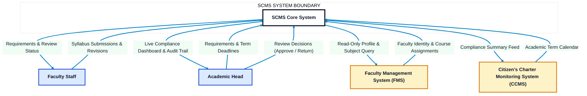
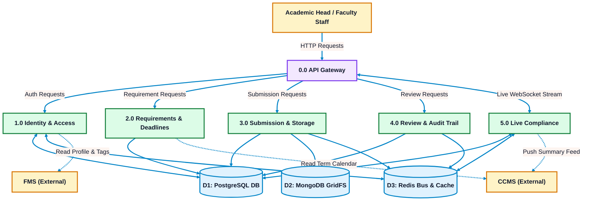
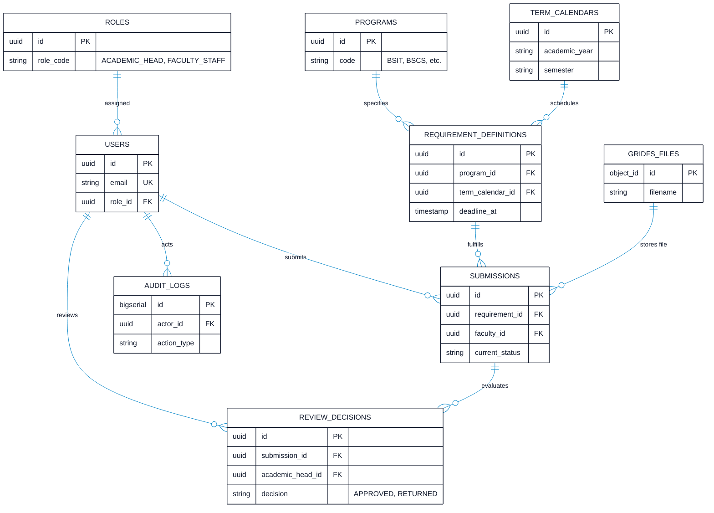
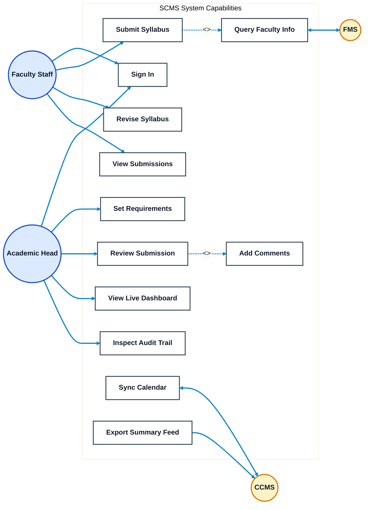
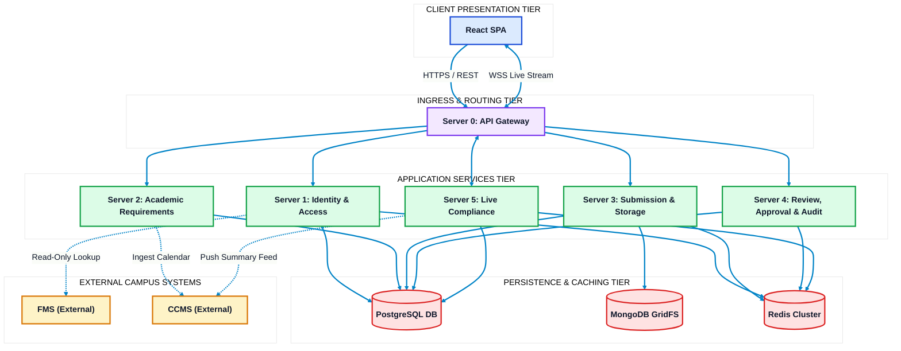
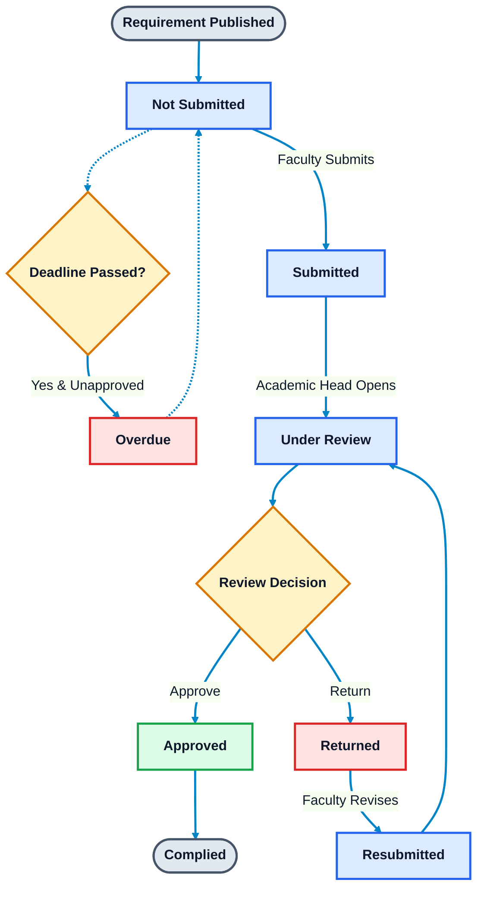
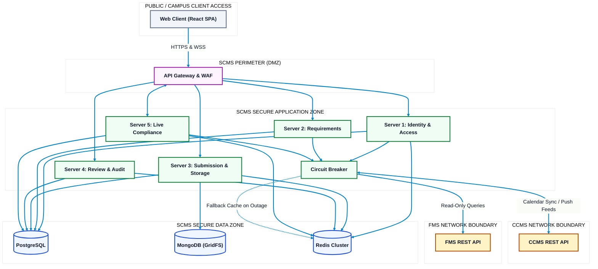

# Syllabus Compliance Monitoring System (SCMS)
## System Architecture & Technical Diagrams

**Institution:** Polytechnic University of the Philippines — Quezon City Campus (PUPQC)  
**Proposed by:** Donayre, Tablizo, Asusula, Bellen  
**Core Technologies:** React SPA, NestJS / Node.js Microservices, PostgreSQL, MongoDB (GridFS), Redis (Pub/Sub & Queues), WebSocket API Gateway  
**Operational Scope:** Exactly two user roles (**Academic Head** & **Faculty Staff**), real-time live compliance dashboard, direct compliance status model  
**Diagram Design Standard:** High-contrast, pure white background (`#FFFFFF`), bright visible connectors (`#0284C7`), and **clean minimalist boxes** (concise 1–3 word labels, no bullet lists inside boxes).

---

## 1. Context Diagram (System Context - Level 0)

The Context Diagram defines the operational boundary of SCMS. Exactly two user roles interface with the system: the **Academic Head** (single campus reviewer and administrator) and **Faculty Staff**, alongside external campus systems (**FMS** and **CCMS**).

### Context Boundary Description
* **Academic Head:** Configures term syllabus requirements and deadlines per academic program, reviews submitted syllabi (Approve or Return with comments), monitors live compliance status, and inspects the audit trail.
* **Faculty Staff:** Views active program requirements and deadlines, uploads or enters syllabi, receives review feedback, and resubmits revisions.
* **Faculty Management System (FMS):** External read-only source for verified faculty profiles and assigned subject codes.
* **Citizen's Charter Monitoring System (CCMS):** Ingests official academic term calendar dates and receives consolidated compliance summary feeds.

---

## 2. Dataflow Diagram (Level 1 DFD)

The Level 1 Dataflow Diagram illustrates data movement between external entities, core operational processes, and polyglot data stores.

### Data Stores Breakdown
* **D1 (PostgreSQL DB):** ACID transactional authority for user credentials, roles, program requirements, deadlines, submission status machine, and immutable audit logs.
* **D2 (MongoDB GridFS):** High-capacity binary chunk storage for PDF and DOCX syllabus files and flexible rubric form schemas.
* **D3 (Redis Bus & Cache):** In-memory WebSocket pub/sub live event dispatcher, BullMQ job queue for overdue evaluations, and FMS offline fallback cache.

---

## 3. Entity Relationship Diagram (ERD)

The ERD models the relational and document data architecture. Boxes display essential primary keys (PK), foreign keys (FK), and core discriminators without visual clutter.

### Schema Field Reference Table

| Entity | Full Attribute Set | Purpose |
| :--- | :--- | :--- |
| **USERS** | `id`, `email`, `password_hash`, `first_name`, `last_name`, `fms_faculty_id`, `role_id`, `is_active`, `created_at` | Local user accounts (No SSO dependency) |
| **ROLES** | `id`, `role_code`, `description` | Strict two-role scope (`ACADEMIC_HEAD`, `FACULTY_STAFF`) |
| **PROGRAMS** | `id`, `code`, `name` | Academic programs (e.g., BSIT, BSCS, BSED, etc.) |
| **TERM_CALENDARS** | `id`, `academic_year`, `semester`, `start_date`, `end_date` | Term boundaries ingested from CCMS or set manually |
| **REQUIREMENT_DEFINITIONS** | `id`, `program_id`, `term_calendar_id`, `requirement_type`, `title`, `deadline_at`, `status` | Configured submission quotas and term deadlines |
| **SUBMISSIONS** | `id`, `requirement_id`, `faculty_id`, `subject_code`, `subject_title`, `current_status`, `is_overdue`, `mongo_file_id`, `submitted_at`, `approved_at` | Central state machine record tracking direct compliance |
| **REVIEW_DECISIONS** | `id`, `submission_id`, `academic_head_id`, `decision`, `comments`, `decided_at` | Single-reviewer evaluation record |
| **AUDIT_LOGS** | `id`, `actor_id`, `action_type`, `entity_name`, `entity_id`, `client_ip`, `created_at` | Append-only immutable log for all administrative and user actions |
| **GRIDFS_FILES** | `_id`, `filename`, `length`, `chunkSize`, `uploadDate`, `contentType` | Binary storage for syllabus PDFs and Word documents |

---

## 4. Use Case Diagram

The Use Case Diagram displays capabilities granted exclusively to the **Academic Head** and **Faculty Staff**, alongside external integration hooks.

---

## 5. System Architecture Diagram (Multi-Tier)

This diagram details the physical and logical multi-tier microservices architecture. Boxes contain concise identifiers; tier details and responsibilities are described below.

### Microservices Responsibility Matrix

| Service | Host Port | Role & Key Responsibilities |
| :--- | :--- | :--- |
| **Server 0: API Gateway** | `:3000` | Ingress TLS termination, rate limiting, JWT token validation, WebSocket live compliance stream routing. |
| **Server 1: Identity & Access** | `:3001` | Local user authentication (Argon2id), RBAC enforcement for 2 roles, read-only FMS profile lookup adapter. |
| **Server 2: Requirements Service** | `:3002` | Program requirements definition, term deadlines management, CCMS academic calendar synchronization. |
| **Server 3: Submission & Storage** | `:3003` | Multipart file uploads (PDF/DOCX), MongoDB GridFS file handling, status transitions, Redis event publishing. |
| **Server 4: Review, Approval & Audit** | `:3004` | Academic Head single-reviewer workflow (Approve / Return), review comment storage, append-only immutable audit trail. |
| **Server 5: Live Compliance** | `:3005` | Real-time status counts aggregation, BullMQ overdue evaluation cron, CCMS summary feed dispatcher. |

---

## 6. Workflow Diagram (Submission Lifecycle & State Machine)

The Submission Lifecycle Diagram defines the deterministic transitions of a syllabus from publication through compliance, including the overdue trigger and revision cycles.

### Direct Compliance Status Definitions
* **`Not Submitted`:** Requirement has been published by the Academic Head; no file or form has been submitted yet by the faculty member.
* **`Submitted`:** Initial syllabus file or rubric form uploaded by Faculty Staff; awaiting evaluation.
* **`Under Review`:** Academic Head has opened the submission for review.
* **`Returned`:** Academic Head evaluated the submission, determined revisions are needed, and recorded constructive comments.
* **`Resubmitted`:** Faculty Staff addressed feedback and uploaded a revised syllabus version.
* **`Approved`:** Academic Head accepted the syllabus; submission is marked **Complied**.
* **`Overdue`:** The configured term deadline elapsed while the submission was not in an `Approved` state.

---

## 7. Integrated Architecture Diagram (Network & Trust Boundaries)

This diagram outlines security zones, network perimeters, ingress trust boundaries, and circuit breaker protection between internal services and external campus APIs.

### Security & Perimeter Specifications
* **Perimeter Zone (DMZ):** Terminates HTTPS/TLS 1.3, executes Web Application Firewall (WAF) rule sets, mitigates brute-force attacks via rate limiters, and authenticates JWT cookie signatures before passing traffic inward.
* **Secure Application Zone:** Microservices run on an isolated container network. Services communicate through internal REST/gRPC endpoints and publish state events onto Redis.
* **Secure Data Zone:** PostgreSQL, MongoDB, and Redis are completely unexposed to public interfaces and accept connections exclusively from authenticated backend microservices.
* **External Integration Resilience:** The Circuit Breaker protects against FMS or CCMS latency or downtime. If an external system fails, cached data in Redis is served with graceful degradation flags.
